<!-- SPDX-License-Identifier: GPL-3.0-or-later -->
<!-- GENERATED by tools/graphs/generate.py from tools/graphs/history.json, ROADMAP.md and docs/AUDIT.md.
     Do not edit: run the generator. CI verifies it with
         python tools/graphs/generate.py --check
-->

# Every crate and every file, over time

One picture per crate and one per source file. Each says what the file is for, in its own words, and then its life: a row for each release that changed it, a row for what has landed since the last release, and a row for what the roadmap has ahead for it.

| Square | Means |
|---|---|
| **done** | A feature or other change, landed |
| **fixed** | A fix: a change that names an audit finding |
| **next** | On the roadmap and being worked on now |
| **planned** | A planned feature, on the roadmap, not started |
| **patch** | A planned patch: outstanding work a finding points to |
| **blocked** | Waiting on something outside the code |

Point at a square to read the change or the roadmap item it stands for. GitHub shows a picture as an image, which has no hover, so open one from the website, or open the file itself, to read them. One square is one change, not one size of change.

The changes come from the commit history, recorded through 10 Nov 2026 by `python tools/graphs/generate.py --record`. What is ahead comes from [`ROADMAP.md`](../../ROADMAP.md), and a planned item is a patch when a finding in [`docs/AUDIT.md`](../../docs/AUDIT.md) ties it to the file.

## Crates

### fuzz


### veilvoice-audio


### veilvoice-cli


### veilvoice-conversation


### veilvoice-core


### veilvoice-crypto


### veilvoice-guard


### veilvoice-gui


### veilvoice-meta


### veilvoice-policy


### veilvoice-setup


### veilvoice-verify


### veilvoice-video


### veilvoice-watch


## Files

### .cargo

- [`audit.toml`](files/dot-cargo/audit.toml.svg): cargo-audit policy.
- [`config.toml`](files/dot-cargo/config.toml.svg): Portable cargo configuration.

### .github

- [`dependabot.yml`](files/dot-github/dependabot.yml.svg): VeilVoice dependency monitoring.

### .github/workflows

- [`ci.yml`](files/dot-github/workflows/ci.yml.svg): Build, lint and test on every supported platform.
- [`codeql.yml`](files/dot-github/workflows/codeql.yml.svg): Static analysis of everything in this repository that runs.
- [`fuzz.yml`](files/dot-github/workflows/fuzz.yml.svg): The seven coverage-guided fuzz targets, run from the committed corpus.
- [`mutants.yml`](files/dot-github/workflows/mutants.yml.svg): Mutation testing over the cryptography, weekly.
- [`packages.yml`](files/dot-github/workflows/packages.yml.svg): The installer packages: two Windows MSIs, the Microsoft Store MSIX, the AppImage and the RPMs.
- [`pages.yml`](files/dot-github/workflows/pages.yml.svg): Publish website/ to GitHub Pages.
- [`promote.yml`](files/dot-github/workflows/promote.yml.svg): Cut a release: prove the tip of main is ready, and start the build.
- [`release.yml`](files/dot-github/workflows/release.yml.svg): Build, verify and publish release artefacts for a v* tag.
- [`rewrite.yml`](files/dot-github/workflows/rewrite.yml.svg): Builds the signed rewrite of main with the key in the repository's secrets, GPG_PRIVATE_KEY and GPG_PASSPHRASE, and hands it over as a bundle in a commit of its own, because the run's token may not push a rewrite of commits that touch workflow files.
- [`scorecard.yml`](files/dot-github/workflows/scorecard.yml.svg): The OpenSSF Scorecard, run here rather than remembered.
- [`signing.yml`](files/dot-github/workflows/signing.yml.svg): Proves that the signing key held in the repository's secrets makes commits GitHub shows as Verified for tilas01, before any history is signed with it.
- [`wiki.yml`](files/dot-github/workflows/wiki.yml.svg): Check wiki/ on every push, and publish it to the repository's GitHub wiki when a release is published.

### (top level)

- [`Cargo.toml`](files/Cargo.toml.svg): VeilVoice: cryptographically-modulated, irreversible voice de-identification.

### assets

- [`generate.py`](files/assets/generate.py.svg): Generate VeilVoice's icon and banner.

### assets/linux

- [`veilvoice.desktop`](files/assets/linux/veilvoice.desktop.svg)

### crates/veilvoice-audio

- [`Cargo.toml`](files/crates/veilvoice-audio/Cargo.toml.svg): Real-time capture and playback (cpal), lock-free ring buffers, virtual-cable routing and file import for VeilVoice.

### crates/veilvoice-audio/src

- [`absent.rs`](files/crates/veilvoice-audio/src/absent.rs.svg): The live modules, in a build that has no live capture.
- [`call.rs`](files/crates/veilvoice-audio/src/call.rs.svg): Roadmap item 188.
- [`devices.rs`](files/crates/veilvoice-audio/src/devices.rs.svg): Enumerating audio devices, and guessing which of them are virtual cables.
- [`io.rs`](files/crates/veilvoice-audio/src/io.rs.svg): Reading and writing audio files.
- [`kinds.rs`](files/crates/veilvoice-audio/src/kinds.rs.svg): What the live path reports, kept apart from the live path itself.
- [`lib.rs`](files/crates/veilvoice-audio/src/lib.rs.svg): Everything between the sound hardware and veilvoice_core: device enumeration, file import and export, and the real-time capture → de-identify → playback path.
- [`live.rs`](files/crates/veilvoice-audio/src/live.rs.svg): Live microphone scrambling.
- [`meter.rs`](files/crates/veilvoice-audio/src/meter.rs.svg): The scale a level meter is drawn on.
- [`playback.rs`](files/crates/veilvoice-audio/src/playback.rs.svg): Playing a recording that is only in memory, and never on disk.
- [`record.rs`](files/crates/veilvoice-audio/src/record.rs.svg): Recording the veiled voice without it ever reaching unprotected memory.
- [`room.rs`](files/crates/veilvoice-audio/src/room.rs.svg): Roadmap item 147.

### crates/veilvoice-cli

- [`Cargo.toml`](files/crates/veilvoice-cli/Cargo.toml.svg): Command-line interface for VeilVoice: anonymise files, scramble a microphone live, strip metadata, encrypt recordings.
- [`build.rs`](files/crates/veilvoice-cli/build.rs.svg): Embed the Windows application icon and version information.

### crates/veilvoice-cli/src

- [`accel.rs`](files/crates/veilvoice-cli/src/accel.rs.svg): veilvoice accel reports the graphics hardware here, and what it is good for.
- [`appctl.rs`](files/crates/veilvoice-cli/src/appctl.rs.svg): veilvoice appctl learns what normally runs, so it can notice what does not.
- [`atrest.rs`](files/crates/veilvoice-cli/src/atrest.rs.svg): Encryption at rest for the recordings VeilVoice writes, and the passphrase prompts that feed it.
- [`capture.rs`](files/crates/veilvoice-cli/src/capture.rs.svg): veilvoice capture -- which screen recorders are running, and which of them you have said you meant to run.
- [`conversation.rs`](files/crates/veilvoice-cli/src/conversation.rs.svg): veilvoice conversation -- several speakers, a voice each, and subtitles.
- [`decoy.rs`](files/crates/veilvoice-cli/src/decoy.rs.svg): veilvoice decoy, and what a second passphrase is worth and what it is not.
- [`failsafe.rs`](files/crates/veilvoice-cli/src/failsafe.rs.svg): veilvoice failsafe is the safety catch.
- [`guard.rs`](files/crates/veilvoice-cli/src/guard.rs.svg): veilvoice guard -- record what VeilVoice's files should be, and check them.
- [`gui.rs`](files/crates/veilvoice-cli/src/gui.rs.svg): veilvoice gui opens the desktop application from the command line.
- [`input.rs`](files/crates/veilvoice-cli/src/input.rs.svg): veilvoice input shows which running programs can see your keyboard and mouse.
- [`lock.rs`](files/crates/veilvoice-cli/src/lock.rs.svg): veilvoice lock manages the application lock from the command line.
- [`main.rs`](files/crates/veilvoice-cli/src/main.rs.svg): veilvoice, the command-line interface.
- [`mandate.rs`](files/crates/veilvoice-cli/src/mandate.rs.svg): veilvoice mandate -- the two things VeilVoice insists on, and how to stop.
- [`meter.rs`](files/crates/veilvoice-cli/src/meter.rs.svg): Level meters for veilvoice live, on a scale that means something.
- [`policy.rs`](files/crates/veilvoice-cli/src/policy.rs.svg): veilvoice policy -- settings that can only be tightened.
- [`priv_mode.rs`](files/crates/veilvoice-cli/src/priv_mode.rs.svg): veilvoice privilege shows what VeilVoice runs with, and what it can see.
- [`record.rs`](files/crates/veilvoice-cli/src/record.rs.svg): veilvoice record -- capture the veiled voice straight into an encrypted file.
- [`reseal.rs`](files/crates/veilvoice-cli/src/reseal.rs.svg): veilvoice reseal: repairing files that were sealed under no passphrase.
- [`reset.rs`](files/crates/veilvoice-cli/src/reset.rs.svg): veilvoice reset: putting this machine back to a new install.
- [`sentry.rs`](files/crates/veilvoice-cli/src/sentry.rs.svg): veilvoice sentry -- canaries, baselines, and what changed since.
- [`theme.rs`](files/crates/veilvoice-cli/src/theme.rs.svg): Tokyo Night colouring for the terminal.
- [`update.rs`](files/crates/veilvoice-cli/src/update.rs.svg): veilvoice update: fetch the new release, check it, and put it in place.

### crates/veilvoice-conversation

- [`Cargo.toml`](files/crates/veilvoice-conversation/Cargo.toml.svg): Several speakers in one recording: who spoke when, a distinct voice for each, names, and subtitles.

### crates/veilvoice-conversation/src

- [`edit.rs`](files/crates/veilvoice-conversation/src/edit.rs.svg): Correcting a plan: who is speaking when, what they are called, and in what colour.
- [`lib.rs`](files/crates/veilvoice-conversation/src/lib.rs.svg): Several people in one recording: a plan of who spoke when, a distinct destination voice for each of them, and subtitles that carry their names.
- [`mode.rs`](files/crates/veilvoice-conversation/src/mode.rs.svg): How many voices a group gets, and the trade between the two answers.
- [`plan.rs`](files/crates/veilvoice-conversation/src/plan.rs.svg): Who is in the recording, and who is speaking when.
- [`render.rs`](files/crates/veilvoice-conversation/src/render.rs.svg): Turning a plan and a recording into veiled audio, one engine per speaker.
- [`subtitles.rs`](files/crates/veilvoice-conversation/src/subtitles.rs.svg): Subtitles, from the same plan the audio is rendered from.

### crates/veilvoice-core

- [`Cargo.toml`](files/crates/veilvoice-core/Cargo.toml.svg): Irreversible voice de-identification DSP engine: cryptographically-modulated pitch/formant scrambling with preserved intelligibility.

### crates/veilvoice-core/examples

- [`spectrum_report.rs`](files/crates/veilvoice-core/examples/spectrum_report.rs.svg): Where do the output partials actually land?
- [`veil_a_buffer.rs`](files/crates/veilvoice-core/examples/veil_a_buffer.rs.svg)

### crates/veilvoice-core/src

- [`accent.rs`](files/crates/veilvoice-core/src/accent.rs.svg): Accent and speaker-trait neutralisation.
- [`chain.rs`](files/crates/veilvoice-core/src/chain.rs.svg): The assembled de-identification chain and its live performance statistics.
- [`effects.rs`](files/crates/veilvoice-core/src/effects.rs.svg): Light time-domain effects applied after resynthesis.
- [`lib.rs`](files/crates/veilvoice-core/src/lib.rs.svg): The security-critical heart of VeilVoice: an irreversible, cryptographically modulated voice de-identification engine.
- [`modulation.rs`](files/crates/veilvoice-core/src/modulation.rs.svg): Cryptographically-seeded modulation of the effect parameters.
- [`pitch.rs`](files/crates/veilvoice-core/src/pitch.rs.svg): Monophonic fundamental-frequency tracker (decimated YIN).
- [`spectral.rs`](files/crates/veilvoice-core/src/spectral.rs.svg): Frequency-domain de-identification transform.
- [`stft.rs`](files/crates/veilvoice-core/src/stft.rs.svg): Streaming short-time Fourier transform with overlap-add resynthesis.
- [`voices.rs`](files/crates/veilvoice-core/src/voices.rs.svg): Destination voices: several canonical registers instead of one.
- [`window.rs`](files/crates/veilvoice-core/src/window.rs.svg): Analysis and synthesis windowing, and the one constant that keeps overlap-add honest.

### crates/veilvoice-core/tests

- [`hostile_audio.rs`](files/crates/veilvoice-core/tests/hostile_audio.rs.svg): The engine against input that is not well-behaved audio.

### crates/veilvoice-crypto

- [`Cargo.toml`](files/crates/veilvoice-crypto/Cargo.toml.svg): Argon2id KDF, X25519+ML-KEM-768 hybrid KEM, XChaCha20-Poly1305 at-rest encryption and page-locked amnesic secrets for VeilVoice.

### crates/veilvoice-crypto/examples

- [`seal_and_open.rs`](files/crates/veilvoice-crypto/examples/seal_and_open.rs.svg)

### crates/veilvoice-crypto/src

- [`aead.rs`](files/crates/veilvoice-crypto/src/aead.rs.svg): Authenticated encryption with XChaCha20-Poly1305.
- [`amnesia.rs`](files/crates/veilvoice-crypto/src/amnesia.rs.svg): Amnesic secret storage: page-locked, zeroized, and never printed.
- [`container.rs`](files/crates/veilvoice-crypto/src/container.rs.svg): The .veil encrypted container format.
- [`decoy.rs`](files/crates/veilvoice-crypto/src/decoy.rs.svg): A second passphrase that opens a different, empty VeilVoice.
- [`hoard.rs`](files/crates/veilvoice-crypto/src/hoard.rs.svg): The obfuscated program folder: what VeilVoice keeps on disk, under names that mean nothing and beside files that hold nothing.
- [`hybrid.rs`](files/crates/veilvoice-crypto/src/hybrid.rs.svg): Post-quantum hybrid key encapsulation: X25519 + ML-KEM-768.
- [`kdf.rs`](files/crates/veilvoice-crypto/src/kdf.rs.svg): Password-based key derivation with Argon2id.
- [`layout.rs`](files/crates/veilvoice-crypto/src/layout.rs.svg): Everything VeilVoice keeps between runs, in one list.
- [`lib.rs`](files/crates/veilvoice-crypto/src/lib.rs.svg): Key derivation, post-quantum-hybrid key agreement, authenticated encryption and amnesic secret storage for VeilVoice.
- [`lock.rs`](files/crates/veilvoice-crypto/src/lock.rs.svg): The application lock: an Argon2id password verifier with a rate limit.
- [`privatefile.rs`](files/crates/veilvoice-crypto/src/privatefile.rs.svg): Writing a file that only its owner can read.
- [`reseal.rs`](files/crates/veilvoice-crypto/src/reseal.rs.svg): Finding files that were sealed under no passphrase at all, and sealing them again under a real one.
- [`reset.rs`](files/crates/veilvoice-crypto/src/reset.rs.svg): Putting this machine back to a new install.
- [`shred.rs`](files/crates/veilvoice-crypto/src/shred.rs.svg): Secure erasure, the self-destruct.
- [`studio.rs`](files/crates/veilvoice-crypto/src/studio.rs.svg): The studio vault: a key that exists only when both locks have been opened.
- [`tape.rs`](files/crates/veilvoice-crypto/src/tape.rs.svg): A recording held in locked, zeroizing memory while it is still being made.
- [`vault.rs`](files/crates/veilvoice-crypto/src/vault.rs.svg): Where the app lock is kept: two copies, unpredictable names, and a restore.
- [`weave.rs`](files/crates/veilvoice-crypto/src/weave.rs.svg): Thirty-one reversible encodings, chosen at random, applied around the encryption -- before it, after it, or both.

### crates/veilvoice-crypto/tests

- [`parser_fuzz.rs`](files/crates/veilvoice-crypto/tests/parser_fuzz.rs.svg): Randomised robustness testing for the two parsers that read untrusted input.
- [`timing.rs`](files/crates/veilvoice-crypto/tests/timing.rs.svg): Timing measurement of the password paths.

### crates/veilvoice-guard

- [`Cargo.toml`](files/crates/veilvoice-guard/Cargo.toml.svg): Integrity manifest and tamper detection for VeilVoice's own files, with best-effort attribution of what changed them.

### crates/veilvoice-guard/src

- [`blame.rs`](files/crates/veilvoice-guard/src/blame.rs.svg): Best-effort attribution: which program changed a file.

### crates/veilvoice-guard/src/failsafe

- [`act.rs`](files/crates/veilvoice-guard/src/failsafe/act.rs.svg): Actually closing a program, kept apart from deciding to.
- [`mod.rs`](files/crates/veilvoice-guard/src/failsafe/mod.rs.svg): Failsafe: nothing leaves this machine in your own voice by accident.

### crates/veilvoice-guard/src

- [`lib.rs`](files/crates/veilvoice-guard/src/lib.rs.svg): Tamper detection for VeilVoice's own files: a manifest of what they should be, a check of what they are, and a best-effort answer to "what changed them".
- [`manifest.rs`](files/crates/veilvoice-guard/src/manifest.rs.svg): The integrity manifest: what the files were, and what they are now.
- [`record.rs`](files/crates/veilvoice-guard/src/record.rs.svg): Where the integrity record is kept.

### crates/veilvoice-guard/src/sentry

- [`canary.rs`](files/crates/veilvoice-guard/src/sentry/canary.rs.svg): Decoy files that should never change, and a record of what they were.
- [`mod.rs`](files/crates/veilvoice-guard/src/sentry/mod.rs.svg): An early warning that something is going through your files: decoy files that should never change, and a measure of how fast a directory tree is changing.
- [`rate.rs`](files/crates/veilvoice-guard/src/sentry/rate.rs.svg): How much of a directory tree changed, and how fast.

### crates/veilvoice-gui

- [`Cargo.toml`](files/crates/veilvoice-gui/Cargo.toml.svg): egui/eframe front-end for VeilVoice: Tokyo Night, monospace, three modes.
- [`build.rs`](files/crates/veilvoice-gui/build.rs.svg): Embed the Windows application icon and version information.

### crates/veilvoice-gui/src

- [`app.rs`](files/crates/veilvoice-gui/src/app.rs.svg): The VeilVoice desktop application: seven tabs, one window, no menus.
- [`autolock.rs`](files/crates/veilvoice-gui/src/autolock.rs.svg): Locking the window again after a period of no use.
- [`avnotice.rs`](files/crates/veilvoice-gui/src/avnotice.rs.svg): Noticing when antivirus software has closed VeilVoice, and saying so kindly.
- [`crashlog.rs`](files/crates/veilvoice-gui/src/crashlog.rs.svg): Make a failure that produces no output produce some.
- [`crashreport.rs`](files/crates/veilvoice-gui/src/crashreport.rs.svg): Offering the report from the last crash, on the run after it.
- [`decoys.rs`](files/crates/veilvoice-gui/src/decoys.rs.svg): Decoy vaults: how many there is room for, and the panel that offers them.

### crates/veilvoice-gui/src/decoys

- [`tests.rs`](files/crates/veilvoice-gui/src/decoys/tests.rs.svg): What the panel offers, checked without a disk or a window.

### crates/veilvoice-gui/src

- [`dialog.rs`](files/crates/veilvoice-gui/src/dialog.rs.svg): Asking for a file without stopping the window.
- [`exporting.rs`](files/crates/veilvoice-gui/src/exporting.rs.svg): The Browser's export, the way a recording tool does it, and its thumbnails.
- [`firstrun.rs`](files/crates/veilvoice-gui/src/firstrun.rs.svg): The first run: the four things worth deciding before anything else.
- [`graphics.rs`](files/crates/veilvoice-gui/src/graphics.rs.svg): What the window is drawn with, asked for explicitly and then reported.
- [`group.rs`](files/crates/veilvoice-gui/src/group.rs.svg): Group mode: several people in one recording, each with a name and a colour.
- [`integrity.rs`](files/crates/veilvoice-gui/src/integrity.rs.svg): The integrity record, taken and checked by the window rather than by hand.
- [`layout.rs`](files/crates/veilvoice-gui/src/layout.rs.svg): Centring a row of widgets, which egui does not do by nesting.
- [`lib.rs`](files/crates/veilvoice-gui/src/lib.rs.svg): The VeilVoice desktop application: an egui/eframe front-end, monospace throughout: anonymise a file, scramble a microphone live, watch what is listening, manage the app lock, choose how the app looks, and an about panel that states the honest scope.
- [`main.rs`](files/crates/veilvoice-gui/src/main.rs.svg): Entry point for the desktop application: open a window, hand it to veilvoice_gui::VeilVoiceApp, and get out of the way.
- [`monitor.rs`](files/crates/veilvoice-gui/src/monitor.rs.svg): The live monitor: what is going in, and what is coming out, wherever you are.
- [`notify.rs`](files/crates/veilvoice-gui/src/notify.rs.svg): How the application tells you something, and the three ways to be told.
- [`offthread.rs`](files/crates/veilvoice-gui/src/offthread.rs.svg): One answer, worked out somewhere that is not the thread drawing the window.
- [`pace.rs`](files/crates/veilvoice-gui/src/pace.rs.svg): How often the window draws while something in it is moving, and what that actually came to.
- [`palettes.rs`](files/crates/veilvoice-gui/src/palettes.rs.svg): User-defined colour schemes, and the contrast check that keeps them usable.
- [`paths.rs`](files/crates/veilvoice-gui/src/paths.rs.svg): Exactly where this copy of VeilVoice is keeping things.

### crates/veilvoice-gui/src/paths

- [`tests.rs`](files/crates/veilvoice-gui/src/paths/tests.rs.svg): That the panel reports every location, and reports them truthfully.

### crates/veilvoice-gui/src

- [`policy.rs`](files/crates/veilvoice-gui/src/policy.rs.svg): The policy in force, and what the interface does about it.
- [`prefs.rs`](files/crates/veilvoice-gui/src/prefs.rs.svg): What the user has chosen about how the app looks and moves.
- [`probe.rs`](files/crates/veilvoice-gui/src/probe.rs.svg): What this machine answers, so the settings it starts on were measured here.
- [`progress.rs`](files/crates/veilvoice-gui/src/progress.rs.svg): How far through a job is, in the two cases that exist: the ones that can honestly say, and the ones that cannot.
- [`reduced_motion.rs`](files/crates/veilvoice-gui/src/reduced_motion.rs.svg): Whether the operating system has been asked to reduce motion.
- [`reset.rs`](files/crates/veilvoice-gui/src/reset.rs.svg): Starting again from the window: what would go, then going.
- [`security.rs`](files/crates/veilvoice-gui/src/security.rs.svg): The application lock, and the at-rest encryption of what VeilVoice writes.
- [`settings.rs`](files/crates/veilvoice-gui/src/settings.rs.svg): The settings panel: a menu of pages, each a titled group of choices.
- [`setup.rs`](files/crates/veilvoice-gui/src/setup.rs.svg): The setup tab: install this copy, undo that, and the optional companions.
- [`soundbar.rs`](files/crates/veilvoice-gui/src/soundbar.rs.svg): The animated mark: a row of bars that rise and fall.
- [`storage.rs`](files/crates/veilvoice-gui/src/storage.rs.svg): Where veiled recordings are written, and the encrypted volume that may hold them.
- [`studio.rs`](files/crates/veilvoice-gui/src/studio.rs.svg): The Recording Studio and the Recording Browser.

### crates/veilvoice-gui/src/studio

- [`tests.rs`](files/crates/veilvoice-gui/src/studio/tests.rs.svg): What the Studio has to get right, tested without a window.

### crates/veilvoice-gui/src

- [`theme.rs`](files/crates/veilvoice-gui/src/theme.rs.svg): Colour schemes for the desktop app.
- [`tour.rs`](files/crates/veilvoice-gui/src/tour.rs.svg): The short walkthrough on a first run, and after an upgrade.
- [`updates.rs`](files/crates/veilvoice-gui/src/updates.rs.svg): The manual update check, as the window shows it.
- [`vault_store.rs`](files/crates/veilvoice-gui/src/vault_store.rs.svg): Where the desktop application keeps its own files, and what the app lock buys for them.
- [`verify.rs`](files/crates/veilvoice-gui/src/verify.rs.svg): The verify tab: drop a download on the window and be told what it is.
- [`watchfeed.rs`](files/crates/veilvoice-gui/src/watchfeed.rs.svg): The device monitor, moved off the thread that paints.
- [`window.rs`](files/crates/veilvoice-gui/src/window.rs.svg): How big the window opens, and why it is not a constant.

### crates/veilvoice-meta

- [`Cargo.toml`](files/crates/veilvoice-meta/Cargo.toml.svg): Strip or spoof identifying metadata: audio tags, and image EXIF/GPS.

### crates/veilvoice-meta/src

- [`audio.rs`](files/crates/veilvoice-meta/src/audio.rs.svg): Audio tag removal and replacement.
- [`image.rs`](files/crates/veilvoice-meta/src/image.rs.svg): Image EXIF/GPS removal.
- [`lib.rs`](files/crates/veilvoice-meta/src/lib.rs.svg): Strip or spoof the identifying metadata that rides along with media files.
- [`wav.rs`](files/crates/veilvoice-meta/src/wav.rs.svg): Chunk-level RIFF/WAVE metadata removal.

### crates/veilvoice-meta/tests

- [`wav_fuzz.rs`](files/crates/veilvoice-meta/tests/wav_fuzz.rs.svg): Randomised robustness testing for the RIFF chunk walker.

### crates/veilvoice-policy

- [`Cargo.toml`](files/crates/veilvoice-policy/Cargo.toml.svg): Settings that can only be tightened, sealed with the project's own post-quantum cryptography.

### crates/veilvoice-policy/src

- [`lib.rs`](files/crates/veilvoice-policy/src/lib.rs.svg): Settings somebody else decided, sealed so they cannot be edited without a passphrase, and, more importantly, built so that editing them without one buys nothing worth having.
- [`mandate.rs`](files/crates/veilvoice-policy/src/mandate.rs.svg): The two things VeilVoice insists on unless you say otherwise.
- [`policy.rs`](files/crates/veilvoice-policy/src/policy.rs.svg): The policy itself: what can be required, and what requiring it does.
- [`workspace.rs`](files/crates/veilvoice-policy/src/workspace.rs.svg): Named profiles and saved projects.

### crates/veilvoice-setup

- [`Cargo.toml`](files/crates/veilvoice-setup/Cargo.toml.svg): Per-user installation and companion-software detection, shared by the command line and the desktop app.

### crates/veilvoice-setup/src

- [`companions.rs`](files/crates/veilvoice-setup/src/companions.rs.svg): Optional third-party software, detected rather than assumed.
- [`install.rs`](files/crates/veilvoice-setup/src/install.rs.svg): Put this program somewhere the system can find it.
- [`lib.rs`](files/crates/veilvoice-setup/src/lib.rs.svg): Everything that puts VeilVoice on a machine, and everything that reports what is already on it.
- [`needs.rs`](files/crates/veilvoice-setup/src/needs.rs.svg): What this machine is missing, asked once and at the right moment.
- [`space.rs`](files/crates/veilvoice-setup/src/space.rs.svg): How much room is actually free where VeilVoice keeps things.

### crates/veilvoice-setup/src/space

- [`tests.rs`](files/crates/veilvoice-setup/src/space/tests.rs.svg): The parsers, against real output from platforms this cannot run on.

### crates/veilvoice-setup/src

- [`update.rs`](files/crates/veilvoice-setup/src/update.rs.svg): Ask, only when told to, whether a newer VeilVoice release exists.
- [`volumes.rs`](files/crates/veilvoice-setup/src/volumes.rs.svg): Encrypted volumes this machine already has: Cryptomator and VeraCrypt.

### crates/veilvoice-verify

- [`Cargo.toml`](files/crates/veilvoice-verify/Cargo.toml.svg): Verify a VeilVoice release without GnuPG installed
- [`build.rs`](files/crates/veilvoice-verify/build.rs.svg): Embed the Windows application icon and version information.

### crates/veilvoice-verify/src

- [`builder.rs`](files/crates/veilvoice-verify/src/builder.rs.svg): Build VeilVoice here, and compare what came out against what was published.

### crates/veilvoice-verify/src/check/archive

- [`mod.rs`](files/crates/veilvoice-verify/src/check/archive/mod.rs.svg): Roadmap item 164.
- [`tar.rs`](files/crates/veilvoice-verify/src/check/archive/tar.rs.svg): Walking a tar stream and hashing every regular file in it.
- [`zip.rs`](files/crates/veilvoice-verify/src/check/archive/zip.rs.svg): Reading a zip central directory and hashing every file in it.

### crates/veilvoice-verify/src/check

- [`carried.rs`](files/crates/veilvoice-verify/src/check/carried.rs.svg): Roadmap item 164.
- [`contents.rs`](files/crates/veilvoice-verify/src/check/contents.rs.svg): The signed list of what is inside each release archive.
- [`machine.rs`](files/crates/veilvoice-verify/src/check/machine.rs.svg): Roadmap item 164.
- [`mod.rs`](files/crates/veilvoice-verify/src/check/mod.rs.svg): Check a VeilVoice release: a file's SHA-256, its line in a SHA256SUMS, and the detached OpenPGP signature over that list.
- [`reproduce.rs`](files/crates/veilvoice-verify/src/check/reproduce.rs.svg): A script that rebuilds a release and compares it with what was published.
- [`seen.rs`](files/crates/veilvoice-verify/src/check/seen.rs.svg): Roadmap item 164.

### crates/veilvoice-verify/src

- [`deps.rs`](files/crates/veilvoice-verify/src/deps.rs.svg): What this machine needs before it can build VeilVoice, and who ships it.
- [`discover.rs`](files/crates/veilvoice-verify/src/discover.rs.svg): Finding a release to check, without being told where it is.
- [`extracted.rs`](files/crates/veilvoice-verify/src/extracted.rs.svg): What came out of the archive, and the GnuPG somebody already has.
- [`fetch.rs`](files/crates/veilvoice-verify/src/fetch.rs.svg): Download a release, without putting an HTTP client in the dependency graph.

### crates/veilvoice-verify/src/gnupg

- [`backend.rs`](files/crates/veilvoice-verify/src/gnupg/backend.rs.svg): Which program checks the signature, and who decides.
- [`mod.rs`](files/crates/veilvoice-verify/src/gnupg/mod.rs.svg): Run the GnuPG that is already on this machine.
- [`script.rs`](files/crates/veilvoice-verify/src/gnupg/script.rs.svg): A shell script that checks a release, for people who would rather read one.

### crates/veilvoice-verify/src

- [`lib.rs`](files/crates/veilvoice-verify/src/lib.rs.svg): The portable verifier: check a VeilVoice release without GnuPG installed.
- [`report.rs`](files/crates/veilvoice-verify/src/report.rs.svg): How much this program says, and what it returns when it says nothing.
- [`tests.rs`](files/crates/veilvoice-verify/src/tests.rs.svg): The verifier's own tests.
- [`update.rs`](files/crates/veilvoice-verify/src/update.rs.svg): The update that does the update.

### crates/veilvoice-verify/tests

- [`inside_the_archive.rs`](files/crates/veilvoice-verify/tests/inside_the_archive.rs.svg): Roadmap item 164.
- [`release_manifest.rs`](files/crates/veilvoice-verify/tests/release_manifest.rs.svg): Roadmap item 97.

### crates/veilvoice-video

- [`Cargo.toml`](files/crates/veilvoice-video/Cargo.toml.svg): A watchable version of a veiled conversation: a waveform, a circle per speaker, subtitles, and an honest account of what needs ffmpeg.

### crates/veilvoice-video/src

- [`accel.rs`](files/crates/veilvoice-video/src/accel.rs.svg): What hardware this machine has, and the one place VeilVoice can use it.
- [`export.rs`](files/crates/veilvoice-video/src/export.rs.svg): What an export asks, and the ffmpeg command each answer turns into.
- [`ffmpeg.rs`](files/crates/veilvoice-video/src/ffmpeg.rs.svg): The video file, which needs a codec this project does not ship.
- [`font.rs`](files/crates/veilvoice-video/src/font.rs.svg): A monospace face, five pixels by seven, drawn here.
- [`frames.rs`](files/crates/veilvoice-video/src/frames.rs.svg): The video's pictures, and how many of them there really are.
- [`lib.rs`](files/crates/veilvoice-video/src/lib.rs.svg): A watchable version of a veiled conversation: the waveform, a circle per speaker, the title, the subtitles, and a background.
- [`motion.rs`](files/crates/veilvoice-video/src/motion.rs.svg): The moving picture an export draws, and the templates it starts from.
- [`page.rs`](files/crates/veilvoice-video/src/page.rs.svg): The picture: one still for a preview, and one page that plays.
- [`palette.rs`](files/crates/veilvoice-video/src/palette.rs.svg): Colours: the site's own tokens, and one per speaker.
- [`raster.rs`](files/crates/veilvoice-video/src/raster.rs.svg): Pixels, and a PNG to put them in.
- [`size.rs`](files/crates/veilvoice-video/src/size.rs.svg): The size and frame rate a video is rendered at.
- [`waveform.rs`](files/crates/veilvoice-video/src/waveform.rs.svg): The shape of the audio, reduced to something a page can draw.

### crates/veilvoice-watch

- [`Cargo.toml`](files/crates/veilvoice-watch/Cargo.toml.svg): Detect which applications are currently using the microphone and camera, with alerts on change.

### crates/veilvoice-watch/examples

- [`scan_once.rs`](files/crates/veilvoice-watch/examples/scan_once.rs.svg): Print what is using the microphone and camera right now.

### crates/veilvoice-watch/src

- [`appctl.rs`](files/crates/veilvoice-watch/src/appctl.rs.svg): Learn what normally runs on this machine, then notice what does not.

### crates/veilvoice-watch/src/capture

- [`comms.rs`](files/crates/veilvoice-watch/src/capture/comms.rs.svg): Communication programs, and how to put VeilVoice between you and them.
- [`mod.rs`](files/crates/veilvoice-watch/src/capture/mod.rs.svg): Which screen-recording programs are running, an allowlist for the ones you meant to run, and a plain account of the two things this cannot do.
- [`programs.rs`](files/crates/veilvoice-watch/src/capture/programs.rs.svg): The programs this build knows can capture a screen.

### crates/veilvoice-watch/src/drivers

- [`linux.rs`](files/crates/veilvoice-watch/src/drivers/linux.rs.svg): Linux: /proc/modules, cross-checked against /sys/module.
- [`macos.rs`](files/crates/veilvoice-watch/src/drivers/macos.rs.svg): macOS: kmutil showloaded, falling back to kextstat.
- [`mod.rs`](files/crates/veilvoice-watch/src/drivers/mod.rs.svg): What is loaded into the kernel, recorded, and compared later.
- [`windows.rs`](files/crates/veilvoice-watch/src/drivers/windows.rs.svg): Windows: driverquery.exe, which the system already ships.

### crates/veilvoice-watch/src

- [`input.rs`](files/crates/veilvoice-watch/src/input.rs.svg): What on this machine could be watching the keyboard and the mouse.
- [`lib.rs`](files/crates/veilvoice-watch/src/lib.rs.svg): Find out which applications are using your microphone and camera, right now.
- [`linux.rs`](files/crates/veilvoice-watch/src/linux.rs.svg): Linux detection, via open file handles in /proc.
- [`privilege.rs`](files/crates/veilvoice-watch/src/privilege.rs.svg): What privilege VeilVoice is running with, and what each level can actually see.
- [`proc.rs`](files/crates/veilvoice-watch/src/proc.rs.svg): Which processes are running, per platform, and what that cannot tell you.
- [`windows.rs`](files/crates/veilvoice-watch/src/windows.rs.svg): Windows detection, via the Capability Access Manager.

### (top level)

- [`deny.toml`](files/deny.toml.svg): cargo-deny policy: licences, sources and duplicate versions.

### deploy

- [`nginx.conf`](files/deploy/nginx.conf.svg): Serve the VeilVoice website under nginx, the same files GitHub Pages serves.

### fuzz

- [`Cargo.toml`](files/fuzz/Cargo.toml.svg): Coverage-guided fuzzing for every parser in VeilVoice that reads bytes somebody else produced.

### fuzz/fuzz_targets

- [`container_header.rs`](files/fuzz/fuzz_targets/container_header.rs.svg): The .veil container header, coverage-guided.
- [`guard_manifest.rs`](files/fuzz/fuzz_targets/guard_manifest.rs.svg): The integrity manifest parser, coverage-guided.
- [`hybrid_keys.rs`](files/fuzz/fuzz_targets/hybrid_keys.rs.svg): Key and encapsulation decoding, coverage-guided.
- [`lock_file.rs`](files/fuzz/fuzz_targets/lock_file.rs.svg): The app-lock file, coverage-guided.
- [`release_contents.rs`](files/fuzz/fuzz_targets/release_contents.rs.svg): The release contents list parser, coverage-guided.
- [`wav_chunks.rs`](files/fuzz/fuzz_targets/wav_chunks.rs.svg): The RIFF chunk walker in veilvoice-meta, coverage-guided.
- [`wav_preflight.rs`](files/fuzz/fuzz_targets/wav_preflight.rs.svg): The WAV pre-flight in veilvoice-audio, coverage-guided.

### install

- [`install.bat`](files/install/install.bat.svg): SPDX-License-Identifier: GPL-3.0-or-later
- [`install.ps1`](files/install/install.ps1.svg): VeilVoice installer for Windows.
- [`install.sh`](files/install/install.sh.svg): VeilVoice installer for Linux and macOS.

### (top level)

- [`osv-scanner.toml`](files/osv-scanner.toml.svg): osv-scanner policy: the advisories this project has already weighed.

### packaging/aur

- [`PKGBUILD`](files/packaging/aur/PKGBUILD.svg): Maintainer: tilas01 <https://github.com/tilas01>
- [`PKGBUILD-git`](files/packaging/aur/PKGBUILD-git.svg): Maintainer: tilas01 <https://github.com/tilas01>

### packaging/debian

- [`rules`](files/packaging/debian/rules.svg)

### packaging/flatpak

- [`io.github.tilas01.VeilVoice.desktop`](files/packaging/flatpak/io.github.tilas01.VeilVoice.desktop.svg)
- [`io.github.tilas01.VeilVoice.metainfo.xml`](files/packaging/flatpak/io.github.tilas01.VeilVoice.metainfo.xml.svg): No network permission, and that is the whole point rather than an oversight.
- [`io.github.tilas01.VeilVoice.yml`](files/packaging/flatpak/io.github.tilas01.VeilVoice.yml.svg): Flatpak manifest for the VeilVoice desktop application.

### packaging/gentoo/media-sound/veilvoice

- [`metadata.xml`](files/packaging/gentoo/media-sound/veilvoice/metadata.xml.svg)
- [`veilvoice-9999.ebuild`](files/packaging/gentoo/media-sound/veilvoice/veilvoice-9999.ebuild.svg): Copyright 2026 tilas01 Distributed under the terms of the GNU General Public License v3 or later

### packaging/homebrew

- [`veilvoice.rb`](files/packaging/homebrew/veilvoice.rb.svg): Homebrew formula for VeilVoice.

### packaging/msix

- [`AppxManifest.xml`](files/packaging/msix/AppxManifest.xml.svg): The MSIX package for the Microsoft Store.

### packaging/rpm

- [`veilvoice.spec`](files/packaging/rpm/veilvoice.spec.svg): RPM spec for VeilVoice (Fedora, RHEL, openSUSE).

### packaging

- [`veilvoice.desktop`](files/packaging/veilvoice.desktop.svg)

### packaging/wix

- [`veilvoice.wxs`](files/packaging/wix/veilvoice.wxs.svg): WiX source for the two Windows installers.

### (top level)

- [`rust-toolchain.toml`](files/rust-toolchain.toml.svg): Pinned toolchain: a fixed compiler is a prerequisite for bit-for-bit reproducible builds.

### tools/audit

- [`actions.py`](files/tools/audit/actions.py.svg): Every GitHub Action a workflow runs is pinned to a commit, not to a tag.
- [`authorship.py`](files/tools/audit/authorship.py.svg): Every commit is tilas01's in both of its fields, names no assistant, and is signed.
- [`build_output.py`](files/tools/audit/build_output.py.svg): No build output lives inside this repository except where it is expected.
- [`build_prerequisites.py`](files/tools/audit/build_prerequisites.py.svg): What a fresh machine needs before it can build this, said once.
- [`cargo_installs.py`](files/tools/audit/cargo_installs.py.svg): A tool a workflow installs with cargo is named at a version.
- [`checkout_tokens.py`](files/tools/audit/checkout_tokens.py.svg): A checkout that never pushes does not keep the token.
- [`crate_tables.py`](files/tools/audit/crate_tables.py.svg): Every crate in the workspace appears in every table that lists the crates.
- [`dependabot.py`](files/tools/audit/dependabot.py.svg): Every manifest in this tree is covered by a Dependabot entry, aimed at main.
- [`dependencies.py`](files/tools/audit/dependencies.py.svg): Every dependency says what it is for, where it is declared.
- [`documented.py`](files/tools/audit/documented.py.svg): Every item on a generated page has something written under it.
- [`features.py`](files/tools/audit/features.py.svg): Every feature selection a release builds is built here too.
- [`fixtures.py`](files/tools/audit/fixtures.py.svg): A file the build needs is in the commit, not merely on the machine that wrote it.
- [`hidden_text.py`](files/tools/audit/hidden_text.py.svg): No tracked file carries text a reader cannot see.
- [`job_limits.py`](files/tools/audit/job_limits.py.svg): Every job in every workflow says how long it is allowed to take.
- [`network_claims.py`](files/tools/audit/network_claims.py.svg): The manual names every command that reaches the network.
- [`network_wording.py`](files/tools/audit/network_wording.py.svg): No sentence a reader sees may claim more about the network than is true.
- [`platform_table.py`](files/tools/audit/platform_table.py.svg): The table of what runs where says what the release workflow actually builds.
- [`powershell.py`](files/tools/audit/powershell.py.svg): No PowerShell function adds to a script's variable and keeps the result to itself.
- [`publishing.py`](files/tools/audit/publishing.py.svg): The step that publishes a release says which commit it is publishing.
- [`randomness.py`](files/tools/audit/randomness.py.svg): Every random number this project draws comes from a cryptographic source.
- [`reachable.py`](files/tools/audit/reachable.py.svg): Every public item is named by something other than its own declaration.
- [`release_targets.py`](files/tools/audit/release_targets.py.svg): The updater asks for an archive the release workflow actually builds.
- [`rsa_usage.py`](files/tools/audit/rsa_usage.py.svg): No crate reaching pgp may gain an RSA private-key code path.
- [`state_paths.py`](files/tools/audit/state_paths.py.svg): Find state files that one part of VeilVoice writes and another reads.
- [`tables.py`](files/tools/audit/tables.py.svg): Every row of a Markdown table has as many cells as its heading says.
- [`top_permissions.py`](files/tools/audit/top_permissions.py.svg): No workflow grants a write permission to every job at once.
- [`wiki_publish.py`](files/tools/audit/wiki_publish.py.svg): A wiki with no repository behind it skips the publish, and does not fail it.
- [`wording.py`](files/tools/audit/wording.py.svg): Every sentence a person reads is spelt, built and pitched the way a careful person would write it.
- [`workflows.py`](files/tools/audit/workflows.py.svg): The workflows and the Dependabot configuration pass zizmor, and stay hardened.

### tools/docs

- [`commands.py`](files/tools/docs/commands.py.svg): Every command, what it is for, and the same job in the window.
- [`developers.py`](files/tools/docs/developers.py.svg): The developer's way in: what is where, what is enforced, and where to start.
- [`generate.py`](files/tools/docs/generate.py.svg): Generate a README for every crate, a page for every source file, and the website mirror of both.
- [`guides.py`](files/tools/docs/guides.py.svg): One guide per program, assembled from the one guide that describes them all.
- [`sources.py`](files/tools/docs/sources.py.svg): A page, a banner and a workchart for every file the website is made of.
- [`wiki.py`](files/tools/docs/wiki.py.svg): The wiki's landing page, its sidebar, and a page for every prose document.

### tools/graphs

- [`generate.py`](files/tools/graphs/generate.py.svg): A picture of every crate and every source file: what it does, and its timeline.

### tools/loc

- [`count.py`](files/tools/loc/count.py.svg): Functional lines of Rust: lines that hold code, per crate and in total.

### tools/measured

- [`generate.py`](files/tools/measured/generate.py.svg): Numbers this project states about itself, measured rather than remembered.

### tools/mutants

- [`check.py`](files/tools/mutants/check.py.svg): A surviving mutant is a diff somebody reads, not a number that moved.

### tools/package

- [`appimage.sh`](files/tools/package/appimage.sh.svg): Build the AppImage from two programs that were already compiled.
- [`icons.py`](files/tools/package/icons.py.svg): Every picture the Windows packages and the Store listing need, drawn from the mark.
- [`msi.py`](files/tools/package/msi.py.svg): Build the two Windows installers from a folder holding the two programs.
- [`msix.py`](files/tools/package/msix.py.svg): Build the MSIX package for the Microsoft Store.
- [`winget.py`](files/tools/package/winget.py.svg): Write the winget manifests for a published release.

### tools/release

- [`card.py`](files/tools/release/card.py.svg): A picture of what changed, one per release.
- [`check-windows-icons.py`](files/tools/release/check-windows-icons.py.svg): Check that a built Windows executable actually carries its icon.
- [`contents.py`](files/tools/release/contents.py.svg): The signed list of what is inside each release archive.
- [`manpage.py`](files/tools/release/manpage.py.svg): Man pages, written from the command's own --help.
- [`notes.py`](files/tools/release/notes.py.svg): A release's notes, written for the person who just downloaded it.
- [`packaging.py`](files/tools/release/packaging.py.svg): Check that every distribution package agrees with the tree it packages.
- [`readiness.py`](files/tools/release/readiness.py.svg): Is the tip of main ready to be released, and is that version coherent?
- [`version.py`](files/tools/release/version.py.svg): The workspace version, and every other place that repeats it.

### tools/render

- [`probe.py`](files/tools/render/probe.py.svg): Measure the rendered page, rather than reason about it.
- [`shot.py`](files/tools/render/shot.py.svg): Screenshot a page of the site with headless Edge, over the DevTools protocol.

### tools/repo

- [`actions_key.sh`](files/tools/repo/actions_key.sh.svg): Sourced by the scripts the signing and rewrite workflows run.
- [`message_filter.py`](files/tools/repo/message_filter.py.svg): Rewrite one commit message: roadmap "markers" become "roadmap items".
- [`rewrite.py`](files/tools/repo/rewrite.py.svg): Rewrite main so every commit is tilas01's.
- [`rewrite_in_actions.sh`](files/tools/repo/rewrite_in_actions.sh.svg): Run by .github/workflows/rewrite.yml.
- [`sarif_summary.py`](files/tools/repo/sarif_summary.py.svg): Every CodeQL finding, written where somebody reading the run can see it.
- [`signing.py`](files/tools/repo/signing.py.svg): Set this clone up to commit as tilas01 and sign with his key, from the environment.
- [`signing_check.sh`](files/tools/repo/signing_check.sh.svg): Run by .github/workflows/signing.yml, where the signing key is a repository secret.
- [`tidy.py`](files/tools/repo/tidy.py.svg): Branch housekeeping for this repository, run from a machine that can push.

### tools/search-index

- [`generate.py`](files/tools/search-index/generate.py.svg): Build the search index for the repository and the website.

### tools/shots

- [`attrs.py`](files/tools/shots/attrs.py.svg): Make the width and height on each screenshot tag match the file.
- [`crop.py`](files/tools/shots/crop.py.svg): Trim the black border the window capture leaves around each screenshot.
- [`fit.py`](files/tools/shots/fit.py.svg): Make every window capture the same height: the tallest one's content.
- [`gui.ps1`](files/tools/shots/gui.ps1.svg): Photograph every tab of the desktop application, and every page of its Settings tab.
- [`gui.sh`](files/tools/shots/gui.sh.svg): Photograph the desktop application, on Linux, with no display: every tab, every page of the Settings tab, and the locked window.
- [`round.py`](files/tools/shots/round.py.svg): Round the corners of every window capture, in the file rather than in CSS.
- [`sessions.py`](files/tools/shots/sessions.py.svg): Recordings of the programs actually doing something.
- [`taken.py`](files/tools/shots/taken.py.svg): The window captures are of this version of the window.
- [`terminal.py`](files/tools/shots/terminal.py.svg): Pictures of the command line, drawn from its real output.
- [`xwd.py`](files/tools/shots/xwd.py.svg): Turn an X window dump into a PNG, and fingerprint a PNG.

### tools/sign

- [`manifest.py`](files/tools/sign/manifest.py.svg): Generate APPMANIFEST.json: a signed-list VeilVoice can carry about itself.
- [`selfsign.ps1`](files/tools/sign/selfsign.ps1.svg): Generate VeilVoice's self-signed code certificate on Windows, and sign the app manifest with it.
- [`selfsign.sh`](files/tools/sign/selfsign.sh.svg): Generate VeilVoice's self-signed code certificate, and sign an app manifest with it.
- [`selftest.py`](files/tools/sign/selftest.py.svg): Prove the app-manifest tooling still works: round trip, and catch a tamper.
- [`verify.ps1`](files/tools/sign/verify.ps1.svg): Verify a VeilVoice release against its self-signed code certificate, on Windows.
- [`verify.sh`](files/tools/sign/verify.sh.svg): Verify a VeilVoice release against its self-signed code certificate.

### tools/site-tests

- [`addresses.test.js`](files/tools/site-tests/addresses.test.js.svg): Every page says where it lives, and a crawler is told it may read the site.
- [`alignment.test.js`](files/tools/site-tests/alignment.test.js.svg): Buttons line up with the buttons beside them, and a new feature cannot quietly add a row that does not.
- [`anchors.test.js`](files/tools/site-tests/anchors.test.js.svg): Following a link into a page lands on the thing it names, with that thing visible.
- [`audit.test.js`](files/tools/site-tests/audit.test.js.svg): The audit's own arithmetic, and whether every finding it hands out a number to actually has an entry.
- [`banner.test.js`](files/tools/site-tests/banner.test.js.svg): The front-page banner under reduced motion.
- [`characters.test.js`](files/tools/site-tests/characters.test.js.svg): No stray characters, anywhere in the repository.
- [`complexity-probe.js`](files/tools/site-tests/complexity-probe.js.svg): Renders one adversarial document and prints how long it took, in milliseconds, on stdout.
- [`css.test.js`](files/tools/site-tests/css.test.js.svg): Cross-engine invariants for the stylesheets.
- [`diagrams.test.js`](files/tools/site-tests/diagrams.test.js.svg): The generated flowcharts must be drawn at a size a person can read.
- [`html.test.js`](files/tools/site-tests/html.test.js.svg): Structural checks on the published pages.
- [`images.test.js`](files/tools/site-tests/images.test.js.svg): No generated picture may put text outside its own canvas.
- [`links.test.js`](files/tools/site-tests/links.test.js.svg): Every local link in the documentation and the website has to point at something that exists.
- [`markdown.complexity.test.js`](files/tools/site-tests/markdown.complexity.test.js.svg): The renderer must stay *linear* in the size of its input.
- [`markdown.hostile.test.js`](files/tools/site-tests/markdown.hostile.test.js.svg): Hostile-input tests for the site's Markdown renderer.
- [`markdown.render.test.js`](files/tools/site-tests/markdown.render.test.js.svg): Rendering-correctness tests for the site's Markdown renderer.
- [`nav.test.js`](files/tools/site-tests/nav.test.js.svg): Every page on the site carries the same header navigation, and every link in it points at something that exists.
- [`packaging.test.js`](files/tools/site-tests/packaging.test.js.svg): The package definitions, against the version the workspace is actually at.
- [`render-probe.js`](files/tools/site-tests/render-probe.js.svg): Renders every document in the hostile corpus, naming each one before it starts, and exits.
- [`repo.test.js`](files/tools/site-tests/repo.test.js.svg): repo.js is the only module on this site that puts data from a *third party* into the page.
- [`reveal.test.js`](files/tools/site-tests/reveal.test.js.svg): Behaviour tests for the scroll-reveal effect.
- [`run.js`](files/tools/site-tests/run.js.svg): Runs every site test.
- [`scripts.test.js`](files/tools/site-tests/scripts.test.js.svg): A page that carries a feature's markup loads the feature's code.
- [`search.test.js`](files/tools/site-tests/search.test.js.svg): Search: the live one, and the one that works with no JavaScript at all.
- [`source.test.js`](files/tools/site-tests/source.test.js.svg): The source pages, and the links that lead to them.

### tools/site

- [`demo.py`](files/tools/site/demo.py.svg): The facts the website's interactive demonstration is drawn from.
- [`faq.py`](files/tools/site/faq.py.svg): The questions page, rendered from the document that holds the answers.
- [`releases.py`](files/tools/site/releases.py.svg): The releases page: every version, its notes, and its files.
- [`render_markdown.js`](files/tools/site/render_markdown.js.svg): Render Markdown to HTML with the renderer the website already has.
- [`roadmap.py`](files/tools/site/roadmap.py.svg): The roadmap, as a page anybody can read and a picture of where it has got to.
- [`seo.py`](files/tools/site/seo.py.svg): Every page says where it lives, and search engines are told they may read it.
- [`serve.py`](files/tools/site/serve.py.svg): Serve the VeilVoice website locally, exactly as GitHub Pages serves it.
- [`split.py`](files/tools/site/split.py.svg): Give every section of the front page its own address, without a second copy.
- [`wiki_site.py`](files/tools/site/wiki_site.py.svg): The whole GitHub wiki, as pages of this website.
- [`window.py`](files/tools/site/window.py.svg): The real window, compiled for a browser, and kept from going stale.

### tools

- [`verify.py`](files/tools/verify.py.svg): Regenerate everything generated, then run every check, in the right order.

### website

- [`404.html`](files/website/404.html.svg): Not generated.

### website/css

- [`main.css`](files/website/css/main.css.svg): One stylesheet, no framework, no web fonts, no third-party requests of any kind.
- [`themes.css`](files/website/css/themes.css.svg): Colour schemes.

### website

- [`index.html`](files/website/index.html.svg): Declarative, so it costs no script and works with JavaScript off.

### website/js

- [`banner.js`](files/website/js/banner.js.svg): The pause button for the front-page banner.
- [`legal.js`](files/website/js/legal.js.svg): The welcome dialog: licence terms, liability waiver, and the disclosure that this project was built with AI assistance.
- [`markdown.js`](files/website/js/markdown.js.svg): A small Markdown renderer and syntax highlighter.
- [`prefetch.js`](files/website/js/prefetch.js.svg): Fetch, quietly and in the background, the few things a reader is most likely to open next -- so that clicking them is instant instead of a wait.
- [`repo.js`](files/website/js/repo.js.svg): Live repository data: stars, description, latest release, and the README rendered with syntax highlighting.
- [`reveal.js`](files/website/js/reveal.js.svg): Reveal-on-scroll, with one rule that outranks every other consideration: content must never stay invisible.
- [`search.js`](files/website/js/search.js.svg): Search across the whole repository and this website.
- [`sessions.js`](files/website/js/sessions.js.svg): The command line, on the page, typed out.
- [`teleport.js`](files/website/js/teleport.js.svg): Following a link to a section of the page lands on that section's heading, with the heading visible.
- [`theme.js`](files/website/js/theme.js.svg): Theme switching.
- [`verify.js`](files/website/js/verify.js.svg): In-browser SHA-256 verification for downloaded release archives.
- [`walkthrough.js`](files/website/js/walkthrough.js.svg): Every screen of the application as a photograph you pick between, and the command line as a list of jobs rather than a list of flags.

### website/nojs

- [`index.html`](files/website/nojs/index.html.svg): The JavaScript-free VeilVoice site.

### website

- [`search.html`](files/website/search.html.svg): Declarative, so it costs no script and works with JavaScript off.
