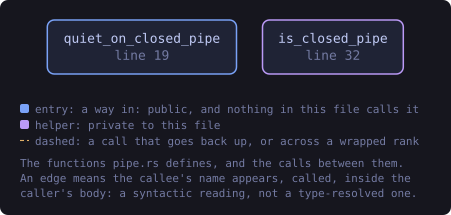
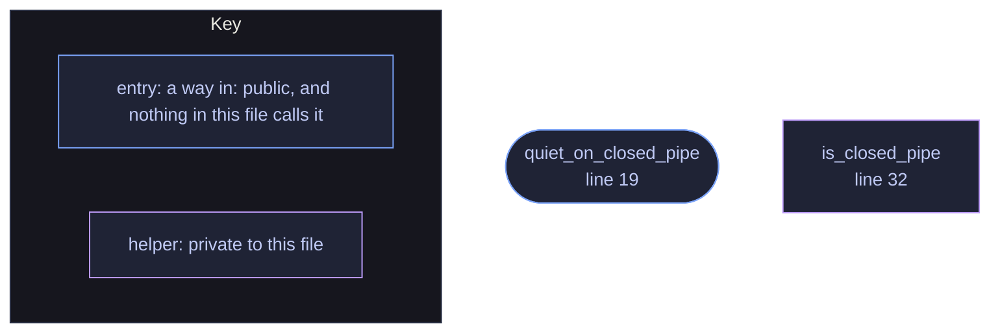

<!-- SPDX-License-Identifier: GPL-3.0-or-later -->
<!-- GENERATED by tools/docs/generate.py from the doc comments in the
     source. Do not edit this file: edit the `//!` and `///` comments in
     the .rs files and run the generator again. CI verifies it with
         python tools/docs/generate.py --check
-->

  

# `crates/veilvoice-cli/src/pipe.rs`

[`veilvoice-cli`](../../../crates/veilvoice-cli/README.md) &middot; 64 lines &middot; [read the source](https://github.com/tilas01/veilvoice/blob/main/crates/veilvoice-cli/src/pipe.rs)

## Contents

- [What this file contains](#what-this-file-contains)
- [What calls what](#what-calls-what)
- [Items](#items)

A reader who stops reading is not a crash.

`println!` panics when standard output is a pipe whose reader has gone,
which is exactly what `veilvoice policy status | head` does after ten
lines. The program printed a panic message, and a hint about backtraces,
under a command that had done what it was asked. A C program would be
ended quietly by `SIGPIPE`, but Rust ignores that signal, and putting it
back needs `unsafe`, which this crate forbids. So the panic is recognised
here and answered with a quiet exit, and every other panic is reported as
it always was.

## What this file contains

64 lines defining **2 functions** (1 public), **0 types** and **1 constant**. Everything below is read out of the source, so it cannot disagree with the code.

**What happens when it runs.** These are the ways in: public, and nothing else in this file calls them, so they are what an outside caller reaches first.

- `quiet_on_closed_pipe` (line 19) -- Install the hook.

## What calls what

The functions this file defines, and the calls between them. Both
are read out of the source: an edge means the callee's name appears,
called, inside the caller's body. It is a syntactic reading, not a
type-resolved one, so a call made through a trait object or a macro
will not appear.

_Colour key: **entry** -- a way in: public, and nothing in this file calls it; **helper** -- private to this file._

  

The same graph as Mermaid source

## Items

| Item | Line | Documentation |
|---|---:|---|
| `CLOSED_PIPE_STATUS` const | [16](https://github.com/tilas01/veilvoice/blob/main/crates/veilvoice-cli/src/pipe.rs#L16) | The status a shell reports for a program SIGPIPE ended: 128 plus the signal's number. |
| `quiet_on_closed_pipe` pub fn | [19](https://github.com/tilas01/veilvoice/blob/main/crates/veilvoice-cli/src/pipe.rs#L19) | Install the hook. |
| `is_closed_pipe` fn | [32](https://github.com/tilas01/veilvoice/blob/main/crates/veilvoice-cli/src/pipe.rs#L32) | Whether a panic message is the standard library reporting that a write to standard output failed because nothing reads it any more: EPIPE on every Unix VeilVoice builds for, and ERROR_NO_DATA on Windows. |

---

Generated from `crates/veilvoice-cli/src/pipe.rs`. On the website: [`website/reference/veilvoice-cli/pipe.html`](../../../website/reference/veilvoice-cli/pipe.html).

Signing key fingerprint `8101FB3BB28D02FB239E0CDF9CC1C7E7A9B5833A`.
