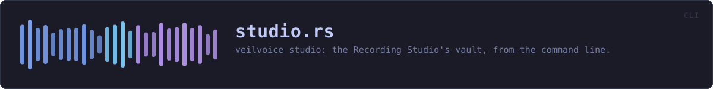
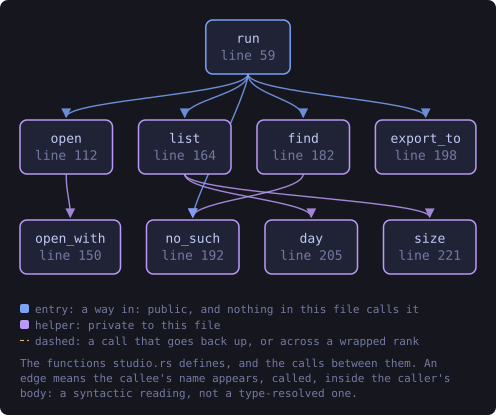
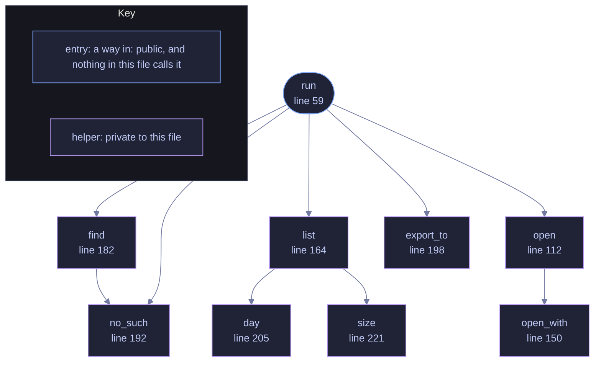

<!-- SPDX-License-Identifier: GPL-3.0-or-later -->
<!-- GENERATED by tools/docs/generate.py from the doc comments in the
     source. Do not edit this file: edit the `//!` and `///` comments in
     the .rs files and run the generator again. CI verifies it with
         python tools/docs/generate.py --check
-->

  

# `crates/veilvoice-cli/src/studio.rs`

[`veilvoice-cli`](../../../crates/veilvoice-cli/README.md) &middot; 299 lines &middot; [read the source](https://github.com/tilas01/veilvoice/blob/main/crates/veilvoice-cli/src/studio.rs)

## Contents

- [What this file contains](#what-this-file-contains)
- [What calls what](#what-calls-what)
- [Items](#items)

`veilvoice studio`: the Recording Studio's vault, from the command line.

The window's Browser lists, plays and exports what the Recording Studio
keeps. This reaches the same vault through the same code, so a machine with
no display, or somebody who would rather type, can reach it too. **F-339**:
until this, the vault had no command at all.

It asks for the two passphrases the window asks for: the app lock's, then
the recording passphrase. The app lock is checked the way the window checks
it, through the decoy store, so the decoy passphrase opens an empty studio
here exactly as it does there, and takes the same time to do it.

It never makes a vault. The window makes one the first time it records, and
asking about an empty folder here says so and leaves the folder empty.

## What this file contains

299 lines defining **9 functions** (1 public), **1 type** and **1 constant**. Everything below is read out of the source, so it cannot disagree with the code.

**The types it owns.**

- `enum Action` (line 26) -- What to do with the vault.

**What happens when it runs.** These are the ways in: public, and nothing else in this file calls them, so they are what an outside caller reaches first.

- `run` (line 59) -- Run one action.
  - reaches: `export_to`, `find`, `list`, `no_such`, `open`, `day`, `size`, `open_with`

## What calls what

The functions this file defines, and the calls between them. Both
are read out of the source: an edge means the callee's name appears,
called, inside the caller's body. It is a syntactic reading, not a
type-resolved one, so a call made through a trait object or a macro
will not appear.

_Colour key: **entry** -- a way in: public, and nothing in this file calls it; **helper** -- private to this file._

  

The same graph as Mermaid source

## Items

| Item | Line | Documentation |
|---|---:|---|
| `Action` pub enum | [26](https://github.com/tilas01/veilvoice/blob/main/crates/veilvoice-cli/src/studio.rs#L26) | What to do with the vault. |
| `WRONG_PAIR` const | [54](https://github.com/tilas01/veilvoice/blob/main/crates/veilvoice-cli/src/studio.rs#L54) | What the window says when the pair of passphrases does not open the vault. |
| `run` pub fn | [59](https://github.com/tilas01/veilvoice/blob/main/crates/veilvoice-cli/src/studio.rs#L59) | Run one action. |
| `open` fn | [112](https://github.com/tilas01/veilvoice/blob/main/crates/veilvoice-cli/src/studio.rs#L112) | Check the app lock and open the vault, or None for an empty studio. |
| `open_with` fn | [150](https://github.com/tilas01/veilvoice/blob/main/crates/veilvoice-cli/src/studio.rs#L150) | Open the vault under parent with the two passphrases, never making one. |
| `list` fn | [164](https://github.com/tilas01/veilvoice/blob/main/crates/veilvoice-cli/src/studio.rs#L164) | Print what the vault holds. |
| `find` fn | [182](https://github.com/tilas01/veilvoice/blob/main/crates/veilvoice-cli/src/studio.rs#L182) | The entry whose id is id. |
| `no_such` fn | [192](https://github.com/tilas01/veilvoice/blob/main/crates/veilvoice-cli/src/studio.rs#L192) | What is said for an id the vault does not hold, decoy or not. |
| `export_to` fn | [198](https://github.com/tilas01/veilvoice/blob/main/crates/veilvoice-cli/src/studio.rs#L198) | Write one recording to path, owner-only, and never over a file that is already there. |
| `day` fn | [205](https://github.com/tilas01/veilvoice/blob/main/crates/veilvoice-cli/src/studio.rs#L205) | A Unix time as the day it fell on, in UTC. |
| `size` fn | [221](https://github.com/tilas01/veilvoice/blob/main/crates/veilvoice-cli/src/studio.rs#L221) | A byte count the way a person reads one. |

---

Generated from `crates/veilvoice-cli/src/studio.rs`. On the website: [`website/reference/veilvoice-cli/studio.html`](../../../website/reference/veilvoice-cli/studio.html).

Signing key fingerprint `8101FB3BB28D02FB239E0CDF9CC1C7E7A9B5833A`.
