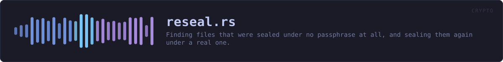
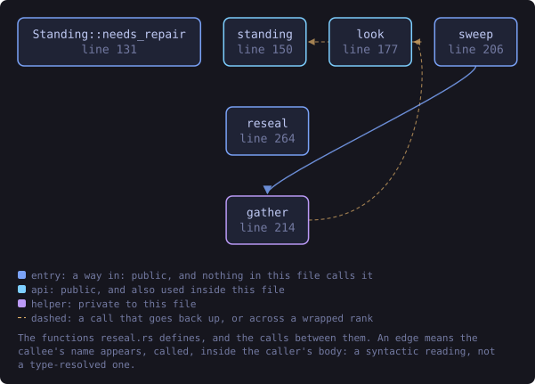
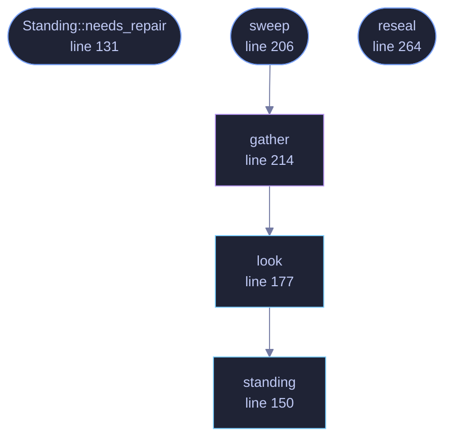

<!-- SPDX-License-Identifier: GPL-3.0-or-later -->
<!-- GENERATED by tools/docs/generate.py from the doc comments in the
     source. Do not edit this file: edit the `//!` and `///` comments in
     the .rs files and run the generator again. CI verifies it with
         python tools/docs/generate.py --check
-->

  

# `crates/veilvoice-crypto/src/reseal.rs`

[`veilvoice-crypto`](../../../crates/veilvoice-crypto/README.md) &middot; 538 lines &middot; [read the source](https://github.com/tilas01/veilvoice/blob/main/crates/veilvoice-crypto/src/reseal.rs)

## Contents

- [The fault this repairs](#the-fault-this-repairs)
- [It looks before it touches](#it-looks-before-it-touches)
- [It refuses anything it did not find open](#it-refuses-anything-it-did-not-find-open)
- [What it cannot do](#what-it-cannot-do)
- [In plain words](#in-plain-words)
  - [What this file contains](#what-this-file-contains)
  - [What calls what](#what-calls-what)
  - [Items](#items)

Finding files that were sealed under no passphrase at all, and sealing them
again under a real one.

# The fault this repairs

Sealing with the app lock became the default in VeilVoice 0.1.15. The
window captured the app-lock passphrase as the lock opened, but wiped the
field before the sealing step collected it, so what reached
`container::seal_with_password` was an empty slice. Every release from
0.1.15 to 0.1.22 could therefore write a recording, and the integrity
record beside it, sealed under nothing.

Such a file looks exactly like any other sealed file. It carries the magic,
a real salt, real Argon2id costs and a valid tag, and it opens for anybody
who passes an empty passphrase, which is to say for anybody at all. Nothing
in it is corrupt, so nothing reports it; the only way to know is to try the
empty passphrase and see whether the tag verifies. That is what this module
does.

# It looks before it touches

`look` answers for one file and `sweep` for a folder, and neither
changes anything. `reseal` is the half that writes, and it takes one path
at a time, so what gets rewritten is a file somebody has seen named.

Judging a file costs one Argon2id derivation, but only for files that are
actually VeilVoice password containers: anything else is refused by the
header parse, which happens before any memory is asked for. A folder of
ordinary files is swept in the time it takes to read them.

The derivation is capped at
[`UNATTENDED_MAX_M_COST`](kdf::KdfParams::UNATTENDED_MAX_M_COST) rather
than the ordinary ceiling, because a sweep is handed whatever is in the
folder rather than a file somebody chose. A container declaring an absurd
memory cost is reported as `Standing::Unreadable` instead of being
allowed to decide how much memory this process asks the operating system
for.

# It refuses anything it did not find open

`reseal` rewrites a file **only** when that file opens with an empty
passphrase, and reports `Error::NotSealedUnderNothing` otherwise. The
refusal is the safety property, not a convenience: a repair that rewrote a
file already sealed under a real passphrase would be destroying the
recording it was asked to protect, and it would be doing so to the files
that were never affected. It also makes the tool safe to run twice, which
matters because the first run may stop part-way through a folder.

The new container is opened again with the new passphrase and compared
against what came out of the old one, before anything is written. Only then
does `crate::privatefile::replace_owner_only` put it in place, as a write
beside the file followed by a rename, so an interrupted repair leaves the
original rather than half of a replacement.

# What it cannot do

It only knows about folders it is given. A recording exported somewhere
else, copied to another machine, or already sent to somebody is outside
anything this can reach, and a file that was sealed under nothing and has
since been read by somebody else stays read: resealing closes the exposure
from now on, it does not undo it. `WARNING` is the wording that says so,
kept here so that the window and the command line say the same thing.

# In plain words

Some versions of VeilVoice locked your recordings with a blank password by
mistake, which means they are not really locked at all. This finds those
files and locks them properly with your real password.

It checks each file by trying the blank password on it. If the file does not
open that way it is already locked properly and this leaves it completely
alone. Nothing is sent anywhere, and your recordings do not change: the same
audio comes out, under a lock that now needs your password.

## What this file contains

538 lines defining **6 functions** (5 public), **2 types** and **2 constants**. Everything below is read out of the source, so it cannot disagree with the code.

**The types it owns.**

- `enum Standing` (line 109) -- Where one file stands with respect to the empty passphrase.
- `struct Found` (line 138) -- One file a sweep looked at, and what it found.

**What happens when it runs.** These are the ways in: public, and nothing else in this file calls them, so they are what an outside caller reaches first.

- `Standing::needs_repair` (line 131) -- Whether reseal would rewrite a file in this state.
- `sweep` (line 206) -- Judge every file under dir, deepest folders included.
  - reaches: `gather`, `look`, `standing`
- `reseal` (line 264) -- Seal path again under password, if and only if it opens under none.

## What calls what

The functions this file defines, and the calls between them. Both
are read out of the source: an edge means the callee's name appears,
called, inside the caller's body. It is a syntactic reading, not a
type-resolved one, so a call made through a trait object or a macro
will not appear.

_Colour key: **entry** -- a way in: public, and nothing in this file calls it; **api** -- public, and also used inside this file; **helper** -- private to this file._

  

The same graph as Mermaid source

## Items

| Item | Line | Documentation |
|---|---:|---|
| `NOTICE` pub const | [88](https://github.com/tilas01/veilvoice/blob/main/crates/veilvoice-crypto/src/reseal.rs#L88) | The one line that points at the repair, for somewhere a paragraph does not fit. |
| `WARNING` pub const | [95](https://github.com/tilas01/veilvoice/blob/main/crates/veilvoice-crypto/src/reseal.rs#L95) | What to tell somebody running VeilVoice 0.1.23 for the first time. |
| `Standing` pub enum | [109](https://github.com/tilas01/veilvoice/blob/main/crates/veilvoice-crypto/src/reseal.rs#L109) | Where one file stands with respect to the empty passphrase. |
| `Standing::needs_repair` pub fn | [131](https://github.com/tilas01/veilvoice/blob/main/crates/veilvoice-crypto/src/reseal.rs#L131) | Whether reseal would rewrite a file in this state. |
| `Found` pub struct | [138](https://github.com/tilas01/veilvoice/blob/main/crates/veilvoice-crypto/src/reseal.rs#L138) | One file a sweep looked at, and what it found. |
| `standing` pub fn | [150](https://github.com/tilas01/veilvoice/blob/main/crates/veilvoice-crypto/src/reseal.rs#L150) | Judge the bytes of a file. |
| `look` pub fn | [177](https://github.com/tilas01/veilvoice/blob/main/crates/veilvoice-crypto/src/reseal.rs#L177) | Judge one file on disk. |
| `sweep` pub fn | [206](https://github.com/tilas01/veilvoice/blob/main/crates/veilvoice-crypto/src/reseal.rs#L206) | Judge every file under dir, deepest folders included. |
| `gather` fn | [214](https://github.com/tilas01/veilvoice/blob/main/crates/veilvoice-crypto/src/reseal.rs#L214) | The recursive half of sweep. |
| `reseal` pub fn | [264](https://github.com/tilas01/veilvoice/blob/main/crates/veilvoice-crypto/src/reseal.rs#L264) | Seal path again under password, if and only if it opens under none. |

---

Generated from `crates/veilvoice-crypto/src/reseal.rs`. On the website: [`website/reference/veilvoice-crypto/reseal.html`](../../../website/reference/veilvoice-crypto/reseal.html).

Signing key fingerprint `8101FB3BB28D02FB239E0CDF9CC1C7E7A9B5833A`.
