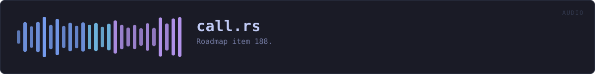
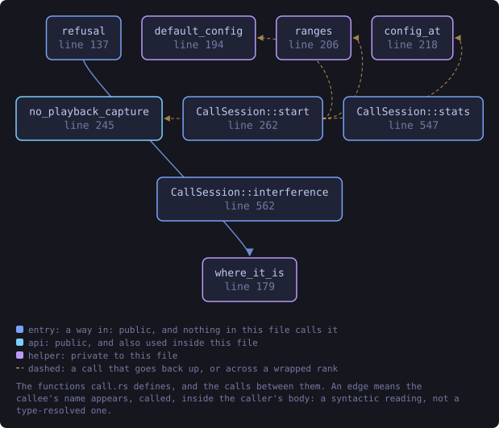
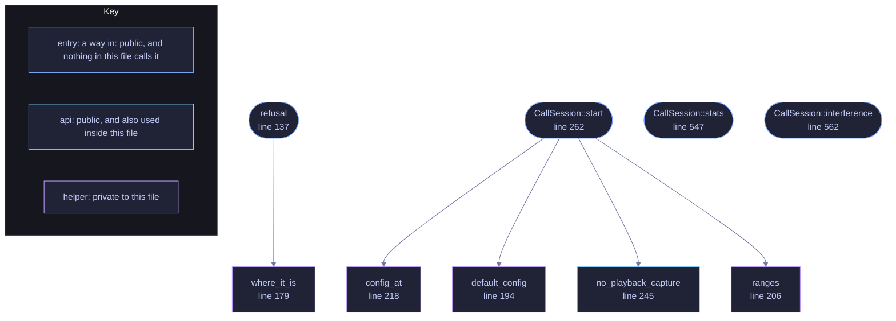

<!-- GENERATED by tools/docs/generate.py from the doc comments in the source. Do not edit: edit the .rs file and run the generator. -->

# `crates/veilvoice-audio/src/call.rs`

[[veilvoice-audio|Crate-veilvoice-audio]] &middot; 716 lines &middot; [read the source](https://github.com/tilas01/veilvoice/blob/main/crates/veilvoice-audio/src/call.rs)

## Contents

- [What this is for](#what-this-is-for)
- [Why one track per side, and not a room](#why-one-track-per-side-and-not-a-room)
- [Each side runs on its own clock, and that is allowed](#each-side-runs-on-its-own-clock-and-that-is-allowed)
- [The engine runs in the input callback](#the-engine-runs-in-the-input-callback)
- [Hearing the call, at the level it arrives](#hearing-the-call-at-the-level-it-arrives)
- [Nothing here tells anybody a call is being recorded](#nothing-here-tells-anybody-a-call-is-being-recorded)
- [In plain words](#in-plain-words)
  - [What calls what](#what-calls-what)
  - [Items](#items)

**Roadmap item 188.** A call, recorded one track per side.

# What this is for

A phone does not give its calls to a computer over a cable. Android has
refused call audio to ordinary apps since Android 9 and iOS has never
offered it. What does work is the call running *through* the computer:
Phone Link on Windows, an iPhone call taken on a Mac, a Linux machine acting
as a Bluetooth hands-free headset, or any calling program on the desktop.
Then the other side comes out of the computer's speakers and you go into its
microphone, and those are two things this crate can open separately.

So a call here is a list of `Party`s, and each one is a device: you on a
`Capture::Microphone`, the other side on `Capture::Playback`, which is
the computer's own output recorded as it plays. A headset splitter cable
from a phone into an audio interface is the same shape with the other side
on a microphone input instead, which is why both are one type rather than
two features.

# Why one track per side, and not a room

[`room`](crate::room) mixes everybody into one output, which is what an
interview going out to a call wants. A call being recorded wants the
opposite. Mixing the other side into an output on this machine would play
them back into the speakers they are being recorded from, and every
choice the person makes is per person: you veiled and them as they are,
them recorded and you not at all. Those are only exact when each side is
its own signal from the first sample, so nothing here mixes.

# Each side runs on its own clock, and that is allowed

A room refuses devices that disagree on a rate, because it mixes them and
nothing in this crate resamples (F-168). A call does not mix, so each side
records at the rate its own device runs at and its engine is configured to
match. A microphone at 44.1 kHz and speakers at 48 kHz is an ordinary
laptop, and refusing it would refuse most calls for a reason that does not
apply.

The one exception is listening. A side that is `Party::heard` is played
to the listening device as it arrives, and that is one output fed from
those sides, so they and it have to agree on a rate exactly as a room does.

# The engine runs in the input callback

There is no output to drive it, so each side's engine runs where that
side's samples arrive. The rule is the one [`live`](crate::live) states:
nothing in a callback allocates, locks or prints. Every buffer is sized
before the stream starts and a block longer than them is processed in
pieces rather than grown into.

# Hearing the call, at the level it arrives

When the call is on the computer it is already playing through the speakers,
and recording it changes nothing about that. When it arrives on a cable it
is not playing anywhere, so a side can be heard: copied, untouched and at
the level it arrived, to the listening device. Nothing scales it. What the
person hears then depends on their own volume control, which is theirs.

# Nothing here tells anybody a call is being recorded

Recording a side reads samples that are already on this machine. It sends
nothing to the call and changes nothing the other side can hear. Telling
them is a separate choice, made by the person, and it is not this module's.

# In plain words

On a call, you and the person you are talking to are recorded separately:
you from the microphone, them from what the computer plays. Each of you can
be disguised or left as you are, and kept or not kept at all. Nobody on the
call is told by this; it only listens to what is already here.

## What this file contains

716 lines defining **9 functions** (5 public), **4 types** and **0 constants**. Everything below is read out of the source, so it cannot disagree with the code.

**The types it owns.**

- `struct Party` (line 84) -- One side of a call: where their voice arrives, and what to do with it.
- `struct KeptCall` (line 103) -- The recorders a call was asked for, one Kept per party in order.
- `struct CallSession` (line 109) -- A running call.
- `struct Shared` (line 120) -- Counted in the audio callbacks, read by the caller.

**What happens when it runs.** These are the ways in: public, and nothing else in this file calls them, so they are what an outside caller reaches first.

- `refusal` (line 137) -- Why a call cannot be recorded as it was described, or None when it can.
  - reaches: `where_it_is`
- `CallSession::start` (line 262) -- Open every party's device and keep what each was asked to keep.
  - reaches: `config_at`, `default_config`, `no_playback_capture`, `ranges`
- `CallSession::stats` (line 547) -- Read the counters, resetting the peak meters.
- `CallSession::interference` (line 562) -- What the platform last reported about any of the streams.

## What calls what

_Colour key: **entry** -- a way in: public, and nothing in this file calls it; **api** -- public, and also used inside this file; **helper** -- private to this file._

  

The same graph as Mermaid source

## Items

| Item | Line | Documentation |
|---|---:|---|
| `Party` pub struct | [84](https://github.com/tilas01/veilvoice/blob/main/crates/veilvoice-audio/src/call.rs#L84) | One side of a call: where their voice arrives, and what to do with it. |
| `KeptCall` pub struct | [103](https://github.com/tilas01/veilvoice/blob/main/crates/veilvoice-audio/src/call.rs#L103) | The recorders a call was asked for, one Kept per party in order. |
| `CallSession` pub struct | [109](https://github.com/tilas01/veilvoice/blob/main/crates/veilvoice-audio/src/call.rs#L109) | A running call. |
| `Shared` struct | [120](https://github.com/tilas01/veilvoice/blob/main/crates/veilvoice-audio/src/call.rs#L120) | Counted in the audio callbacks, read by the caller. |
| `refusal` pub fn | [137](https://github.com/tilas01/veilvoice/blob/main/crates/veilvoice-audio/src/call.rs#L137) | Why a call cannot be recorded as it was described, or None when it can. |
| `where_it_is` fn | [179](https://github.com/tilas01/veilvoice/blob/main/crates/veilvoice-audio/src/call.rs#L179) | A device as a sentence names it. |
| `default_config` fn | [194](https://github.com/tilas01/veilvoice/blob/main/crates/veilvoice-audio/src/call.rs#L194) | The configuration a party's stream opens with. |
| `ranges` fn | [206](https://github.com/tilas01/veilvoice/blob/main/crates/veilvoice-audio/src/call.rs#L206) | What a party's device reports it will take, as plain numbers. |
| `config_at` fn | [218](https://github.com/tilas01/veilvoice/blob/main/crates/veilvoice-audio/src/call.rs#L218) | The configuration a party's device offers at rate. |
| `no_playback_capture` pub fn | [245](https://github.com/tilas01/veilvoice/blob/main/crates/veilvoice-audio/src/call.rs#L245) | Why recording what this computer plays did not open, in words. |
| `CallSession::start` pub fn | [262](https://github.com/tilas01/veilvoice/blob/main/crates/veilvoice-audio/src/call.rs#L262) | Open every party's device and keep what each was asked to keep. |
| `CallSession::stats` pub fn | [547](https://github.com/tilas01/veilvoice/blob/main/crates/veilvoice-audio/src/call.rs#L547) | Read the counters, resetting the peak meters. |
| `CallSession::interference` pub fn | [562](https://github.com/tilas01/veilvoice/blob/main/crates/veilvoice-audio/src/call.rs#L562) | What the platform last reported about any of the streams. |
