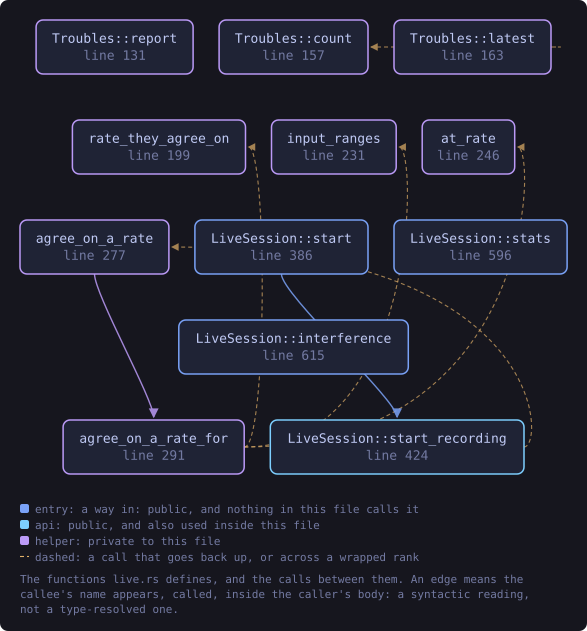
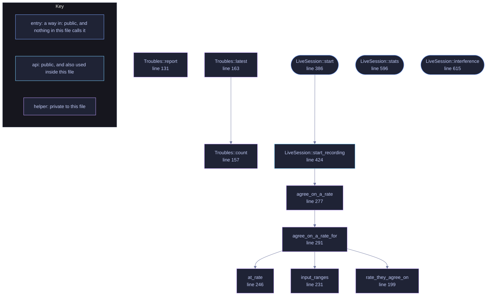

<!-- GENERATED by tools/docs/generate.py from the doc comments in the source. Do not edit: edit the .rs file and run the generator. -->

# `crates/veilvoice-audio/src/live.rs`

[[veilvoice-audio|Crate-veilvoice-audio]] &middot; 867 lines &middot; [read the source](https://github.com/tilas01/veilvoice/blob/main/crates/veilvoice-audio/src/live.rs)

## Contents

- [Structure](#structure)
- [Rules the callbacks follow](#rules-the-callbacks-follow)
- [Latency](#latency)
- [In plain words](#in-plain-words)
  - [What calls what](#what-calls-what)
  - [Items](#items)

Live microphone scrambling.

# Structure

Capture and playback run as two independent callbacks driven by the audio
hardware, joined by a lock-free SPSC ring buffer. The de-identification runs
inside the *output* callback, which is the shortest path: adding a worker
thread would mean a second buffer and a second scheduling delay for no
benefit, and `veilvoice_core::Deidentifier::process` is explicitly
allocation-free and safe to call from an audio callback.

# Rules the callbacks follow

An audio callback that blocks produces a dropout, so neither callback ever
allocates, locks, or waits. Statistics are published through a mutex the
callback only ever *tries* to take: if the UI thread happens to hold it, the
update is skipped rather than the audio stalling.

# Latency

Total latency is the input buffer, plus the ring backlog, plus the engine's
one-frame group delay (~21 ms at the defaults), plus the output buffer. The
ring is intentionally short, enough to absorb jitter between two clocks
that are not synchronised, not enough to accumulate a delay the user would
notice while speaking.

# In plain words

This is live mode: your microphone in one end, a voice that is not yours out
the other, fast enough to hold a conversation.

Sound arrives from the microphone in small pieces, and each one has to be dealt
with before the next arrives. There is no room to be late. So the veiling
happens on the same short path the sound is already travelling, with nothing
queued up behind it and nothing that could pause to allocate memory or wait for
another part of the program.

If the computer ever cannot keep up, that is counted and shown rather than
hidden. A gap in the sound you can see explained is far better than one you
cannot.

## What this file contains

867 lines defining **12 functions** (4 public), **4 types** and **2 constants**. Everything below is read out of the source, so it cannot disagree with the code.

**The types it owns.**

- `struct Kept` (line 63) -- The recorders a session was asked for, one per side of Keeping.
- `struct LiveSession` (line 71) -- A running live-scramble session.
- `struct Shared` (line 87) -- What the audio callbacks and the caller both touch, held behind one handle.
- `struct Troubles` (line 113) -- What the platform has said about a session's streams, counted where it is said and read by whoever asks.

**What happens when it runs.** These are the ways in: public, and nothing else in this file calls them, so they are what an outside caller reaches first.

- `LiveSession::start` (line 386) -- Start scrambling from input into output.
  - reaches: `start_recording`, `agree_on_a_rate`, `agree_on_a_rate_for`, `at_rate`, `input_ranges`, `rate_they_agree_on`
- `LiveSession::stats` (line 596) -- Read the current statistics, resetting the peak meters.
- `LiveSession::interference` (line 615) -- What the platform last reported about either stream.

## What calls what

_Colour key: **entry** -- a way in: public, and nothing in this file calls it; **api** -- public, and also used inside this file; **helper** -- private to this file._

  

The same graph as Mermaid source

## Items

| Item | Line | Documentation |
|---|---:|---|
| `RING_MILLIS` pub(crate) const | [54](https://github.com/tilas01/veilvoice/blob/main/crates/veilvoice-audio/src/live.rs#L54) | How much jitter the ring absorbs before it starts dropping samples. |
| `Kept` pub struct | [63](https://github.com/tilas01/veilvoice/blob/main/crates/veilvoice-audio/src/live.rs#L63) | The recorders a session was asked for, one per side of Keeping. |
| `LiveSession` pub struct | [71](https://github.com/tilas01/veilvoice/blob/main/crates/veilvoice-audio/src/live.rs#L71) | A running live-scramble session. |
| `Shared` struct | [87](https://github.com/tilas01/veilvoice/blob/main/crates/veilvoice-audio/src/live.rs#L87) | What the audio callbacks and the caller both touch, held behind one handle. |
| `Troubles` pub(crate) struct | [113](https://github.com/tilas01/veilvoice/blob/main/crates/veilvoice-audio/src/live.rs#L113) | What the platform has said about a session's streams, counted where it is said and read by whoever asks. |
| `GLITCH` const | [126](https://github.com/tilas01/veilvoice/blob/main/crates/veilvoice-audio/src/live.rs#L126) | What a glitch is called when somebody asks, since the audio thread that reported it does not stop to say. |
| `Troubles::report` pub(crate) fn | [131](https://github.com/tilas01/veilvoice/blob/main/crates/veilvoice-audio/src/live.rs#L131) | Record what the platform said about a stream. |
| `Troubles::count` pub(crate) fn | [157](https://github.com/tilas01/veilvoice/blob/main/crates/veilvoice-audio/src/live.rs#L157) | How many reports there have been, glitches included. |
| `Troubles::latest` pub(crate) fn | [163](https://github.com/tilas01/veilvoice/blob/main/crates/veilvoice-audio/src/live.rs#L163) | The newest report. |
| `rate_they_agree_on` pub(crate) fn | [199](https://github.com/tilas01/veilvoice/blob/main/crates/veilvoice-audio/src/live.rs#L199) | Which sample rate a set of devices can all run at, if any. |
| `input_ranges` pub(crate) fn | [231](https://github.com/tilas01/veilvoice/blob/main/crates/veilvoice-audio/src/live.rs#L231) | The ranges a device reports, as plain numbers. |
| `at_rate` pub(crate) fn | [246](https://github.com/tilas01/veilvoice/blob/main/crates/veilvoice-audio/src/live.rs#L246) | One of a device's configurations at rate, preferring f32. |
| `agree_on_a_rate` fn | [277](https://github.com/tilas01/veilvoice/blob/main/crates/veilvoice-audio/src/live.rs#L277) | A microphone and an output, configured to one rate. |
| `agree_on_a_rate_for` pub(crate) fn | [291](https://github.com/tilas01/veilvoice/blob/main/crates/veilvoice-audio/src/live.rs#L291) | The same, for any number of microphones. |
| `LiveSession::start` pub fn | [386](https://github.com/tilas01/veilvoice/blob/main/crates/veilvoice-audio/src/live.rs#L386) | Start scrambling from input into output. |
| `LiveSession::start_recording` pub fn | [424](https://github.com/tilas01/veilvoice/blob/main/crates/veilvoice-audio/src/live.rs#L424) | Start scrambling, keeping the sides of it Keeping asks for. |
| `LiveSession::stats` pub fn | [596](https://github.com/tilas01/veilvoice/blob/main/crates/veilvoice-audio/src/live.rs#L596) | Read the current statistics, resetting the peak meters. |
| `LiveSession::interference` pub fn | [615](https://github.com/tilas01/veilvoice/blob/main/crates/veilvoice-audio/src/live.rs#L615) | What the platform last reported about either stream. |
