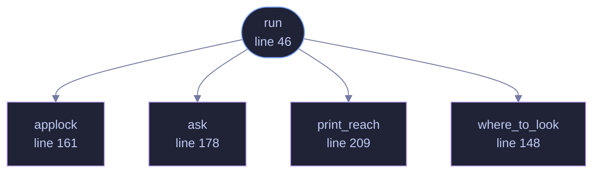

<!-- GENERATED by tools/docs/generate.py from the doc comments in the source. Do not edit: edit the .rs file and run the generator. -->

# `crates/veilvoice-cli/src/reseal.rs`

[[veilvoice-cli|Crate-veilvoice-cli]] &middot; 261 lines &middot; [read the source](https://github.com/tilas01/veilvoice/blob/main/crates/veilvoice-cli/src/reseal.rs)

## Contents

- [Why this command exists](#why-this-command-exists)
- [It shows the list before it asks for anything](#it-shows-the-list-before-it-asks-for-anything)
- [The passphrase is proved against the lock first](#the-passphrase-is-proved-against-the-lock-first)
- [In plain words](#in-plain-words)
  - [What calls what](#what-calls-what)
  - [Items](#items)

`veilvoice reseal`: repairing files that were sealed under no passphrase.

# Why this command exists

`veilvoice_crypto::reseal` has the account of the fault. In short:
releases 0.1.15 to 0.1.22 could seal a recording under an empty passphrase
while reporting that it had been sealed with the app lock, and a file in
that state opens for anybody who has it.

Nothing about such a file is visibly wrong, so there is nothing for a person
to look for. The only way to find them is to try the empty passphrase on
each file and see which ones open, which is what this does.

# It shows the list before it asks for anything

The sweep runs first and prints what it found, including the files that are
sealed properly, so the number of files checked is on the screen next to the
number that need repairing. Only then is a passphrase asked for, and only if
there is something to repair. `--dry-run` stops after the list.

# The passphrase is proved against the lock first

A mistyped passphrase here would reseal every affected recording under a
passphrase nobody knows, which is a worse outcome than the fault. So where
this machine has an app lock, the passphrase has to open it before anything
is written, through the same rate-limited `LockStore::unlock` the window
and `veilvoice lock` use.

Where there is no lock, there is nothing to prove it against, and it is
asked for twice instead. That case is real: somebody who reset their lock
after 0.1.22 still has the recordings it sealed.

# In plain words

Finds recordings that an older VeilVoice locked with a blank password by
mistake, and locks them properly with your real one. It shows you the list
first, and it does not touch anything that was already locked properly.

## What this file contains

261 lines defining **5 functions** (1 public), **0 types** and **0 constants**. Everything below is read out of the source, so it cannot disagree with the code.

**What happens when it runs.** These are the ways in: public, and nothing else in this file calls them, so they are what an outside caller reaches first.

- `run` (line 46) -- Run the repair.
  - reaches: `applock`, `ask`, `print_reach`, `where_to_look`

## What calls what

_Colour key: **entry** -- a way in: public, and nothing in this file calls it; **helper** -- private to this file._

  

The same graph as Mermaid source

## Items

| Item | Line | Documentation |
|---|---:|---|
| `run` pub fn | [46](https://github.com/tilas01/veilvoice/blob/main/crates/veilvoice-cli/src/reseal.rs#L46) | Run the repair. |
| `where_to_look` fn | [148](https://github.com/tilas01/veilvoice/blob/main/crates/veilvoice-cli/src/reseal.rs#L148) | Which folders to sweep: the ones named, or the one VeilVoice writes to. |
| `applock` fn | [161](https://github.com/tilas01/veilvoice/blob/main/crates/veilvoice-cli/src/reseal.rs#L161) | The app lock, where this machine has one. |
| `ask` fn | [178](https://github.com/tilas01/veilvoice/blob/main/crates/veilvoice-cli/src/reseal.rs#L178) | Ask for the passphrase, and prove it before handing it back. |
| `print_reach` fn | [209](https://github.com/tilas01/veilvoice/blob/main/crates/veilvoice-cli/src/reseal.rs#L209) | The honest limit, printed whichever way the sweep went. |
