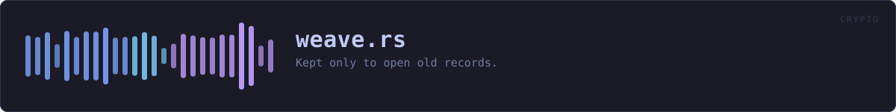
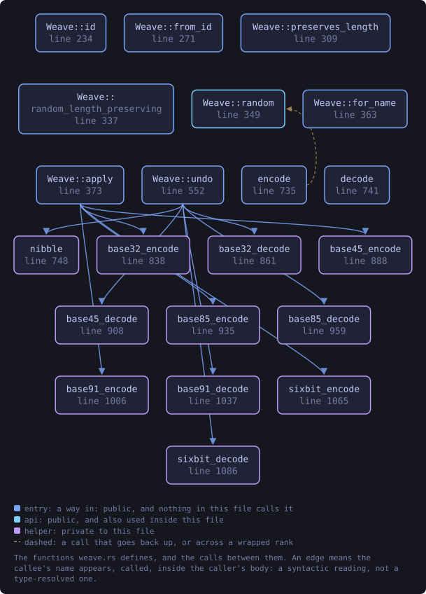

<!-- GENERATED by tools/docs/generate.py from the doc comments in the source. Do not edit: edit the .rs file and run the generator. -->

# `crates/veilvoice-crypto/src/weave.rs`

[veilvoice-crypto](Crate-veilvoice-crypto) &middot; 1818 lines &middot; [read the source](https://github.com/tilas01/veilvoice/blob/main/crates/veilvoice-crypto/src/weave.rs)

## Contents

- [What this buys, and it is not what it looks like](#what-this-buys-and-it-is-not-what-it-looks-like)
- [It is nowhere near the live path, and adds no lag](#it-is-nowhere-near-the-live-path-and-adds-no-lag)
- [Names are different, and the difference matters](#names-are-different-and-the-difference-matters)
- [In plain words](#in-plain-words)
  - [What calls what](#what-calls-what)
  - [Items](#items)

**Kept only to open old records.** Since F-337 the hoard writes without
any of these encodings, and nothing in VeilVoice encodes with them. This
module stays so that a record an older version wrote can still be opened,
and the hoard rewrites each such record in the current format the first
time it is read. It can go once no supported version is likely to have
left one behind.

Thirty-one reversible encodings, chosen at random, applied around the
encryption -- before it, after it, or both.

# What this buys, and it is not what it looks like

Say the disappointing part first, because the alternative is letting a
reader assume it.

**This adds no cryptographic strength.** Every record here is sealed with
ChaCha20-Poly1305, whose output is already indistinguishable from random to
anybody without the key. Encoding the plaintext before encrypting it does
not make that ciphertext harder to break, and anybody who tells you a layer
of base91 under an AEAD is "double encryption" is wrong. If the only thing
standing between an attacker and your data were the encoding, the answer
would be: that is not security, it is a puzzle.

So the honest list of what it does buy, all of it smaller than the previous
paragraph is big:

- **Plaintext that leaks by a route other than the AEAD is not readable.**
A core dump, a swap file, a page that was written before the seal, a
future bug in this crate's own framing -- any of those hands somebody the
plaintext buffer. `frame_ms = 4.25` in that buffer is a sentence. The
same record base91-ed under a move-to-front transform is not, and cannot
be grepped for.
- **After a key compromise there is one more step.** Small, and worth
naming as small: somebody with the passphrase reads the encoding marker
in the first byte and undoes it. It costs them a minute, not a month.
- **A partially-recovered record does not read as text.** Truncated or
damaged plaintext that decodes to nothing is better than truncated
plaintext that decodes to half your settings.

That is the whole claim. It is defence in depth against exposure that does
not go through the cipher, not a second cipher.

# It is nowhere near the live path, and adds no lag

These run only when VeilVoice writes one of its own small files -- settings,
measurements, the integrity record. They never touch a sample of audio. The
DSP and capture crates do not name this module, and cannot, because it is
not in their dependency graph. So "does the encoding slow down the live
scramble" has a structural answer rather than a benchmarked one: the code
that would slow it down is not reachable from it.

Even where they do run, the input is kilobytes and the transforms are a
single linear pass, so the cost is lost in the Argon2id run the same unlock
already pays for.

# Names are different, and the difference matters

A record's filename is 18 bytes of HMAC, base64url-encoded to exactly 24
characters. Weaving those bytes first is fine -- but **only with a codec
that preserves length**.

If a name could be hex-encoded it would come out 48 characters instead of
24, and the length of the filename would announce which encoding was used.
Worse, decoys are random bytes with a random weave while records have a
key-derived one, so a length difference would separate the two at a glance
and undo the entire point of the decoys.

So names use `LENGTH_PRESERVING` only, and the choice is derived from the
key rather than drawn at random, because a name has to be computable again
next time. Contents may use anything, because contents are padded to fixed
buckets afterwards.

One honest consequence of that padding: an expanding codec can push a
record into a larger bucket than a compact one would, so writing the same
data twice can produce two different file sizes. That reveals nothing about
the data -- only that the encoding changed -- and it is the reason bucket
sizes are coarse.

# In plain words

Before VeilVoice encrypts one of its own files, it scrambles the contents
into one of twenty-seven odd formats picked at random, and does something
similar to the filename.

It is not what keeps the file secret. The encryption does that. This means
that if the unencrypted contents ever escape some other way -- a crash
dump, a swap file -- what escapes does not read as anything.

## What this file contains

1818 lines defining **21 functions** (10 public), **1 type** and **18 constants**. Everything below is read out of the source, so it cannot disagree with the code.

**The types it owns.**

- `enum Weave` (line 97) -- Every encoding, by name.

**What happens when it runs.** These are the ways in: public, and nothing else in this file calls them, so they are what an outside caller reaches first.

- `Weave::id` (line 234) -- The marker stored with a record so the encoding can be undone.
- `Weave::from_id` (line 271) -- Recover an encoding from its marker.
- `Weave::preserves_length` (line 309) -- Whether this leaves the byte count untouched.
- `Weave::random_length_preserving` (line 337) -- Pick one at random from the length-preserving set.
- `Weave::for_name` (line 363) -- Pick one deterministically from key material, from LENGTH_PRESERVING.
- `Weave::apply` (line 373) -- Encode.
  - reaches: `base32_encode`, `base45_encode`, `base85_encode`, `base91_encode`, `sixbit_encode`
- `Weave::undo` (line 552) -- Decode.
  - reaches: `base32_decode`, `base45_decode`, `base85_decode`, `base91_decode`, `nibble`, `sixbit_decode`
- `encode` (line 735) -- Encode with a randomly chosen encoding, returning it so it can be undone.
  - reaches: `random`
- `decode` (line 741) -- Undo encode.

## What calls what

_Colour key: **entry** -- a way in: public, and nothing in this file calls it; **api** -- public, and also used inside this file; **helper** -- private to this file._

  

The same graph as Mermaid source

```mermaid
%%{init: {"theme":"base","themeVariables":{"background":"#1a1b26","primaryColor":"#1f2335","primaryTextColor":"#c0caf5","primaryBorderColor":"#7aa2f7","secondaryColor":"#16161e","tertiaryColor":"#16161e","lineColor":"#737aa2","textColor":"#c0caf5","mainBkg":"#1f2335","nodeBorder":"#7aa2f7","clusterBkg":"#16161e","clusterBorder":"#2f3549","fontFamily":"ui-monospace, SFMono-Regular, Consolas, monospace","fontSize":"14px"}}}%%
flowchart TD
    n_id(["Weave::id<br/>line 234"])
    n_from_id(["Weave::from_id<br/>line 271"])
    n_preserves_length(["Weave::preserves_length<br/>line 309"])
    n_random_length_preserving(["Weave::<br/>random_length_preserving<br/>line 337"])
    n_random["Weave::random<br/>line 349"]
    n_for_name(["Weave::for_name<br/>line 363"])
    n_apply(["Weave::apply<br/>line 373"])
    n_undo(["Weave::undo<br/>line 552"])
    n_encode(["encode<br/>line 735"])
    n_decode(["decode<br/>line 741"])
    n_nibble["nibble<br/>line 748"]
    n_base32_encode["base32_encode<br/>line 838"]
    n_base32_decode["base32_decode<br/>line 861"]
    n_base45_encode["base45_encode<br/>line 888"]
    n_base45_decode["base45_decode<br/>line 908"]
    n_base85_encode["base85_encode<br/>line 935"]
    n_base85_decode["base85_decode<br/>line 959"]
    n_base91_encode["base91_encode<br/>line 1006"]
    n_base91_decode["base91_decode<br/>line 1037"]
    n_sixbit_encode["sixbit_encode<br/>line 1065"]
    n_sixbit_decode["sixbit_decode<br/>line 1086"]
    n_apply --> n_base32_encode
    n_apply --> n_base45_encode
    n_apply --> n_base85_encode
    n_apply --> n_base91_encode
    n_apply --> n_sixbit_encode
    n_encode --> n_random
    n_undo --> n_base32_decode
    n_undo --> n_base45_decode
    n_undo --> n_base85_decode
    n_undo --> n_base91_decode
    n_undo --> n_nibble
    n_undo --> n_sixbit_decode
    click n_id href "https://github.com/tilas01/veilvoice/blob/main/crates/veilvoice-crypto/src/weave.rs#L234" "open the source"
    click n_from_id href "https://github.com/tilas01/veilvoice/blob/main/crates/veilvoice-crypto/src/weave.rs#L271" "open the source"
    click n_preserves_length href "https://github.com/tilas01/veilvoice/blob/main/crates/veilvoice-crypto/src/weave.rs#L309" "open the source"
    click n_random_length_preserving href "https://github.com/tilas01/veilvoice/blob/main/crates/veilvoice-crypto/src/weave.rs#L337" "open the source"
    click n_random href "https://github.com/tilas01/veilvoice/blob/main/crates/veilvoice-crypto/src/weave.rs#L349" "open the source"
    click n_for_name href "https://github.com/tilas01/veilvoice/blob/main/crates/veilvoice-crypto/src/weave.rs#L363" "open the source"
    click n_apply href "https://github.com/tilas01/veilvoice/blob/main/crates/veilvoice-crypto/src/weave.rs#L373" "open the source"
    click n_undo href "https://github.com/tilas01/veilvoice/blob/main/crates/veilvoice-crypto/src/weave.rs#L552" "open the source"
    click n_encode href "https://github.com/tilas01/veilvoice/blob/main/crates/veilvoice-crypto/src/weave.rs#L735" "open the source"
    click n_decode href "https://github.com/tilas01/veilvoice/blob/main/crates/veilvoice-crypto/src/weave.rs#L741" "open the source"
    click n_nibble href "https://github.com/tilas01/veilvoice/blob/main/crates/veilvoice-crypto/src/weave.rs#L748" "open the source"
    click n_base32_encode href "https://github.com/tilas01/veilvoice/blob/main/crates/veilvoice-crypto/src/weave.rs#L838" "open the source"
    click n_base32_decode href "https://github.com/tilas01/veilvoice/blob/main/crates/veilvoice-crypto/src/weave.rs#L861" "open the source"
    click n_base45_encode href "https://github.com/tilas01/veilvoice/blob/main/crates/veilvoice-crypto/src/weave.rs#L888" "open the source"
    click n_base45_decode href "https://github.com/tilas01/veilvoice/blob/main/crates/veilvoice-crypto/src/weave.rs#L908" "open the source"
    click n_base85_encode href "https://github.com/tilas01/veilvoice/blob/main/crates/veilvoice-crypto/src/weave.rs#L935" "open the source"
    click n_base85_decode href "https://github.com/tilas01/veilvoice/blob/main/crates/veilvoice-crypto/src/weave.rs#L959" "open the source"
    click n_base91_encode href "https://github.com/tilas01/veilvoice/blob/main/crates/veilvoice-crypto/src/weave.rs#L1006" "open the source"
    click n_base91_decode href "https://github.com/tilas01/veilvoice/blob/main/crates/veilvoice-crypto/src/weave.rs#L1037" "open the source"
    click n_sixbit_encode href "https://github.com/tilas01/veilvoice/blob/main/crates/veilvoice-crypto/src/weave.rs#L1065" "open the source"
    click n_sixbit_decode href "https://github.com/tilas01/veilvoice/blob/main/crates/veilvoice-crypto/src/weave.rs#L1086" "open the source"
    classDef entry fill:#1f2335,stroke:#7aa2f7,color:#c0caf5
    class n_id,n_from_id,n_preserves_length,n_random_length_preserving,n_for_name,n_apply,n_undo,n_encode,n_decode entry
    classDef api fill:#1f2335,stroke:#7dcfff,color:#c0caf5
    class n_random api
    classDef helper fill:#1f2335,stroke:#bb9af7,color:#c0caf5
    class n_nibble,n_base32_encode,n_base32_decode,n_base45_encode,n_base45_decode,n_base85_encode,n_base85_decode,n_base91_encode,n_base91_decode,n_sixbit_encode,n_sixbit_decode helper
    subgraph chart_key ["Key"]
        direction LR
        key_entry["entry: a way in: public, and nothing in this file calls it"]
        key_api["api: public, and also used inside this file"]
        key_helper["helper: private to this file"]
    end
    class key_entry entry
    class key_api api
    class key_helper helper
```

## Items

| Item | Line | Documentation |
|---|---:|---|
| `Weave` pub enum | [97](https://github.com/tilas01/veilvoice/blob/main/crates/veilvoice-crypto/src/weave.rs#L97) | Every encoding, by name. |
| `LENGTH_PRESERVING` pub const | [174](https://github.com/tilas01/veilvoice/blob/main/crates/veilvoice-crypto/src/weave.rs#L174) | Every encoding that leaves the byte count alone. |
| `ALL` pub const | [195](https://github.com/tilas01/veilvoice/blob/main/crates/veilvoice-crypto/src/weave.rs#L195) | Every encoding, for contents. |
| `Weave::id` pub fn | [234](https://github.com/tilas01/veilvoice/blob/main/crates/veilvoice-crypto/src/weave.rs#L234) | The marker stored with a record so the encoding can be undone. |
| `Weave::from_id` pub fn | [271](https://github.com/tilas01/veilvoice/blob/main/crates/veilvoice-crypto/src/weave.rs#L271) | Recover an encoding from its marker. |
| `Weave::preserves_length` pub fn | [309](https://github.com/tilas01/veilvoice/blob/main/crates/veilvoice-crypto/src/weave.rs#L309) | Whether this leaves the byte count untouched. |
| `Weave::random_length_preserving` pub fn | [337](https://github.com/tilas01/veilvoice/blob/main/crates/veilvoice-crypto/src/weave.rs#L337) | Pick one at random from the length-preserving set. |
| `Weave::random` pub fn | [349](https://github.com/tilas01/veilvoice/blob/main/crates/veilvoice-crypto/src/weave.rs#L349) | Pick one at random, from ALL. |
| `Weave::for_name` pub fn | [363](https://github.com/tilas01/veilvoice/blob/main/crates/veilvoice-crypto/src/weave.rs#L363) | Pick one deterministically from key material, from LENGTH_PRESERVING. |
| `Weave::apply` pub fn | [373](https://github.com/tilas01/veilvoice/blob/main/crates/veilvoice-crypto/src/weave.rs#L373) | Encode. |
| `Weave::undo` pub fn | [552](https://github.com/tilas01/veilvoice/blob/main/crates/veilvoice-crypto/src/weave.rs#L552) | Decode. |
| `encode` pub fn | [735](https://github.com/tilas01/veilvoice/blob/main/crates/veilvoice-crypto/src/weave.rs#L735) | Encode with a randomly chosen encoding, returning it so it can be undone. |
| `decode` pub fn | [741](https://github.com/tilas01/veilvoice/blob/main/crates/veilvoice-crypto/src/weave.rs#L741) | Undo encode. |
| `nibble` fn | [748](https://github.com/tilas01/veilvoice/blob/main/crates/veilvoice-crypto/src/weave.rs#L748) | One hex digit as a number, in either case. |
| `HEX` const | [764](https://github.com/tilas01/veilvoice/blob/main/crates/veilvoice-crypto/src/weave.rs#L764) | Hexadecimal, in lower case, which is what this crate writes. |
| `HEX_UPPER` const | [766](https://github.com/tilas01/veilvoice/blob/main/crates/veilvoice-crypto/src/weave.rs#L766) | Hexadecimal in upper case, offered for reading rather than for writing. |
| `B32` const | [769](https://github.com/tilas01/veilvoice/blob/main/crates/veilvoice-crypto/src/weave.rs#L769) | RFC 4648 base32: the letters, then the digits two to seven. |
| `B32HEX` const | [772](https://github.com/tilas01/veilvoice/blob/main/crates/veilvoice-crypto/src/weave.rs#L772) | RFC 4648's extended hex base32, which sorts in the same order as the bytes it stands for, because the digits come first. |
| `ZB32` const | [775](https://github.com/tilas01/veilvoice/blob/main/crates/veilvoice-crypto/src/weave.rs#L775) | z-base-32, ordered so that the characters people read most reliably carry the bits that matter most, and in lower case for the same reason. |
| `CROCKFORD` const | [778](https://github.com/tilas01/veilvoice/blob/main/crates/veilvoice-crypto/src/weave.rs#L778) | Crockford's base32, which drops I, L, O and U: the first three because they are read as digits, the last so no word is spelled by accident. |
| `B45` const | [781](https://github.com/tilas01/veilvoice/blob/main/crates/veilvoice-crypto/src/weave.rs#L781) | The base45 alphabet, whose last nine characters are the punctuation a QR code can carry in its alphanumeric mode, which is what base45 exists for. |
| `A85` const | [784](https://github.com/tilas01/veilvoice/blob/main/crates/veilvoice-crypto/src/weave.rs#L784) | Which of the two base85 layouts base85_encode and base85_decode are working in: Ascii85, whose characters run from ! |
| `Z85A` const | [788](https://github.com/tilas01/veilvoice/blob/main/crates/veilvoice-crypto/src/weave.rs#L788) | The other one: Z85, which uses the alphabet below and no offset. |
| `UU` const | [792](https://github.com/tilas01/veilvoice/blob/main/crates/veilvoice-crypto/src/weave.rs#L792) | Which of the two six-bit layouts sixbit_encode and sixbit_decode are working in: uuencode, which adds thirty-two to each six-bit group and so starts at the space character. |
| `XX` const | [796](https://github.com/tilas01/veilvoice/blob/main/crates/veilvoice-crypto/src/weave.rs#L796) | The other one: xxencode, which indexes the alphabet below instead. |
| `XX_ALPHABET` const | [799](https://github.com/tilas01/veilvoice/blob/main/crates/veilvoice-crypto/src/weave.rs#L799) | xxencode's alphabet, in the order that makes its output survive a mail gateway: no space, and the two characters before the digits are + and -. |
| `Z85_ALPHABET` const | [802](https://github.com/tilas01/veilvoice/blob/main/crates/veilvoice-crypto/src/weave.rs#L802) | Z85's alphabet, whose eighty-five characters are chosen to be safe inside a source-code string literal: no quote, no backslash and no comma. |
| `SBOX` const | [809](https://github.com/tilas01/veilvoice/blob/main/crates/veilvoice-crypto/src/weave.rs#L809) | A fixed permutation of every byte value, and its inverse. |
| `UNSBOX` const | [824](https://github.com/tilas01/veilvoice/blob/main/crates/veilvoice-crypto/src/weave.rs#L824) | SBOX read backwards, so decoding is a lookup rather than a search. |
| `base32_encode` fn | [838](https://github.com/tilas01/veilvoice/blob/main/crates/veilvoice-crypto/src/weave.rs#L838) | Five bytes to eight characters, over whichever 32-character alphabet was chosen. |
| `base32_decode` fn | [861](https://github.com/tilas01/veilvoice/blob/main/crates/veilvoice-crypto/src/weave.rs#L861) | Undo base32_encode over the same alphabet. |
| `base45_encode` fn | [888](https://github.com/tilas01/veilvoice/blob/main/crates/veilvoice-crypto/src/weave.rs#L888) | Two bytes to three characters, over the 45-character alphabet the QR standard uses. |
| `base45_decode` fn | [908](https://github.com/tilas01/veilvoice/blob/main/crates/veilvoice-crypto/src/weave.rs#L908) | Undo base45_encode. |
| `base85_encode` fn | [935](https://github.com/tilas01/veilvoice/blob/main/crates/veilvoice-crypto/src/weave.rs#L935) | Four bytes to five characters. |
| `base85_decode` fn | [959](https://github.com/tilas01/veilvoice/blob/main/crates/veilvoice-crypto/src/weave.rs#L959) | Undo base85_encode with the same flavour and offset. |
| `B91` const | [1001](https://github.com/tilas01/veilvoice/blob/main/crates/veilvoice-crypto/src/weave.rs#L1001) | basE91's alphabet: every printable ASCII character except the space, the apostrophe, the hyphen and the backslash. |
| `base91_encode` fn | [1006](https://github.com/tilas01/veilvoice/blob/main/crates/veilvoice-crypto/src/weave.rs#L1006) | Thirteen or fourteen bits at a time, over 91 characters, which is the densest of these that stays printable ASCII. |
| `base91_decode` fn | [1037](https://github.com/tilas01/veilvoice/blob/main/crates/veilvoice-crypto/src/weave.rs#L1037) | Undo base91_encode. |
| `sixbit_encode` fn | [1065](https://github.com/tilas01/veilvoice/blob/main/crates/veilvoice-crypto/src/weave.rs#L1065) | Three bytes to four characters over a 64-character alphabet, in the shape uuencode and xxencode use. |
| `sixbit_decode` fn | [1086](https://github.com/tilas01/veilvoice/blob/main/crates/veilvoice-crypto/src/weave.rs#L1086) | Undo sixbit_encode with the same flavour. |
