<!-- GENERATED by tools/docs/generate.py from the doc comments in the source. Do not edit: edit the .rs file and run the generator. -->

# `crates/veilvoice-gui/src/vault_store.rs`

[[veilvoice-gui|Crate-veilvoice-gui]] &middot; 943 lines &middot; [read the source](https://github.com/tilas01/veilvoice/blob/main/crates/veilvoice-gui/src/vault_store.rs)

## Contents

- [The short version, and it is the honest one](#the-short-version-and-it-is-the-honest-one)
- [What it still does not buy](#what-it-still-does-not-buy)
- [Moving in, and the risk that comes with it](#moving-in-and-the-risk-that-comes-with-it)
  - [What calls what](#what-calls-what)
  - [Items](#items)

Where the desktop application keeps its own files, and what the app lock
buys for them.

# The short version, and it is the honest one

**With an app lock set**, everything VeilVoice writes about itself lives in
`veilvoice_crypto::hoard`: encrypted, padded to a few fixed sizes, under
filenames derived from the lock passphrase, with decoy files sown among
them. Somebody who opens the folder without the passphrase cannot tell
which file is the settings, which is the integrity record, which holds
anything, and which is junk.

**With no app lock**, none of that is possible and none of it is claimed.
There is no passphrase, so there is no key, so there is nothing to derive a
name from or encrypt with. The files sit in the open under their own names,
exactly as they did before this module existed, and the security tab says
so in those words.

That is the whole bargain, and it is the answer to a fair question about
the app lock: what is it actually *for*, if it is only a password prompt on
a window whose files anybody can read? This is what it is for. Setting a
passphrase is what turns the folder from a set of labelled files into a set
of indistinguishable ones.

# What it still does not buy

Repeated here rather than left in the crypto crate, because this is the
module the application calls and the place somebody looks:

- It does not hide that VeilVoice is installed. The folder is named
`veilvoice` and the lock file is in it under its own name -- it has to
be, since it is what checks the passphrase.
- It does not stop anybody deleting the folder.
- It is no protection at all while the application is open and unlocked.
- Anybody who has the passphrase has everything.

# Moving in, and the risk that comes with it

The first unlock after a lock is set migrates the existing plain files in:
each is read, written as a hoard record, and the original securely erased.

This is the moment to be plain about a consequence that is easy to
under-state. Once the files are in the hoard, **the passphrase is the only
way back to them**. Losing it does not lock you out of a window whose files
you could still read by hand; it loses the settings, the integrity record
and the policies for good. `veilvoice_crypto::lock` keeps a second copy of
the lock for exactly this reason, and the setup screen says the sentence out
loud rather than burying it.

## What this file contains

943 lines defining **15 functions** (13 public), **3 types** and **1 constant**. Everything below is read out of the source, so it cannot disagree with the code.

**The types it owns.**

- `enum Plain` (line 139) -- Whether an unlock moves the plain records in, or leaves them alone.
- `struct VaultStore` (line 155) -- The application's own storage, locked or not.
- `struct Measured` (line 794) -- What the application measured about its own running, kept between sessions.

**What happens when it runs.** These are the ways in: public, and nothing else in this file calls them, so they are what an outside caller reaches first.

- `VaultStore::new` (line 173) -- Point at the program folder.
- `VaultStore::dir` (line 182) -- The program folder, if this platform has one.
- `VaultStore::is_obfuscated` (line 191) -- Whether records are currently obfuscated.
- `VaultStore::start_unlocking` (line 206) -- Take the key from an unlock and start opening the hoard with it.
  - reaches: `open_with`
- `VaultStore::is_opening` (line 225) -- Whether an unlock is still being carried out.
- `VaultStore::poll` (line 233) -- Collect a finished unlock, installing the key.
- `VaultStore::unlocked` (line 265) -- Open the hoard here and now, for tests only.
  - reaches: `open_with`
- `VaultStore::locked` (line 282) -- Forget the key.
- `VaultStore::read` (line 289) -- Read a record, from the hoard if it is open and from the plain file if it is not.
  - reaches: `plain_path`
- `VaultStore::write` (line 304) -- Write a record, obfuscated if there is a key and plain if there is not.
  - reaches: `plain_path`
- `Measured::load` (line 811) -- Read it back, or the defaults if nothing has been recorded.
- `Measured::save` (line 834) -- Write it, obfuscated when there is a key and plain when there is not.
- `Measured::record` (line 848) -- Fold this session's numbers in.

## What calls what

_Colour key: **entry** -- a way in: public, and nothing in this file calls it; **helper** -- private to this file._

  

The same graph as Mermaid source

```mermaid
%%{init: {"theme":"base","themeVariables":{"background":"#1a1b26","primaryColor":"#1f2335","primaryTextColor":"#c0caf5","primaryBorderColor":"#7aa2f7","secondaryColor":"#16161e","tertiaryColor":"#16161e","lineColor":"#737aa2","textColor":"#c0caf5","mainBkg":"#1f2335","nodeBorder":"#7aa2f7","clusterBkg":"#16161e","clusterBorder":"#2f3549","fontFamily":"ui-monospace, SFMono-Regular, Consolas, monospace","fontSize":"14px"}}}%%
flowchart TD
    n_new(["VaultStore::new<br/>line 173"])
    n_dir(["VaultStore::dir<br/>line 182"])
    n_is_obfuscated(["VaultStore::is_obfuscated<br/>line 191"])
    n_start_unlocking(["VaultStore::start_unlocking<br/>line 206"])
    n_is_opening(["VaultStore::is_opening<br/>line 225"])
    n_poll(["VaultStore::poll<br/>line 233"])
    n_unlocked(["VaultStore::unlocked<br/>line 265"])
    n_locked(["VaultStore::locked<br/>line 282"])
    n_read(["VaultStore::read<br/>line 289"])
    n_write(["VaultStore::write<br/>line 304"])
    n_plain_path["VaultStore::plain_path<br/>line 318"]
    n_open_with["open_with<br/>line 357"]
    n_load(["Measured::load<br/>line 811"])
    n_save(["Measured::save<br/>line 834"])
    n_record(["Measured::record<br/>line 848"])
    n_read --> n_plain_path
    n_start_unlocking --> n_open_with
    n_unlocked --> n_open_with
    n_write --> n_plain_path
    click n_new href "https://github.com/tilas01/veilvoice/blob/main/crates/veilvoice-gui/src/vault_store.rs#L173" "open the source"
    click n_dir href "https://github.com/tilas01/veilvoice/blob/main/crates/veilvoice-gui/src/vault_store.rs#L182" "open the source"
    click n_is_obfuscated href "https://github.com/tilas01/veilvoice/blob/main/crates/veilvoice-gui/src/vault_store.rs#L191" "open the source"
    click n_start_unlocking href "https://github.com/tilas01/veilvoice/blob/main/crates/veilvoice-gui/src/vault_store.rs#L206" "open the source"
    click n_is_opening href "https://github.com/tilas01/veilvoice/blob/main/crates/veilvoice-gui/src/vault_store.rs#L225" "open the source"
    click n_poll href "https://github.com/tilas01/veilvoice/blob/main/crates/veilvoice-gui/src/vault_store.rs#L233" "open the source"
    click n_unlocked href "https://github.com/tilas01/veilvoice/blob/main/crates/veilvoice-gui/src/vault_store.rs#L265" "open the source"
    click n_locked href "https://github.com/tilas01/veilvoice/blob/main/crates/veilvoice-gui/src/vault_store.rs#L282" "open the source"
    click n_read href "https://github.com/tilas01/veilvoice/blob/main/crates/veilvoice-gui/src/vault_store.rs#L289" "open the source"
    click n_write href "https://github.com/tilas01/veilvoice/blob/main/crates/veilvoice-gui/src/vault_store.rs#L304" "open the source"
    click n_plain_path href "https://github.com/tilas01/veilvoice/blob/main/crates/veilvoice-gui/src/vault_store.rs#L318" "open the source"
    click n_open_with href "https://github.com/tilas01/veilvoice/blob/main/crates/veilvoice-gui/src/vault_store.rs#L357" "open the source"
    click n_load href "https://github.com/tilas01/veilvoice/blob/main/crates/veilvoice-gui/src/vault_store.rs#L811" "open the source"
    click n_save href "https://github.com/tilas01/veilvoice/blob/main/crates/veilvoice-gui/src/vault_store.rs#L834" "open the source"
    click n_record href "https://github.com/tilas01/veilvoice/blob/main/crates/veilvoice-gui/src/vault_store.rs#L848" "open the source"
    classDef entry fill:#1f2335,stroke:#7aa2f7,color:#c0caf5
    class n_new,n_dir,n_is_obfuscated,n_start_unlocking,n_is_opening,n_poll,n_unlocked,n_locked,n_read,n_write,n_load,n_save,n_record entry
    classDef helper fill:#1f2335,stroke:#bb9af7,color:#c0caf5
    class n_plain_path,n_open_with helper
```

## Items

| Item | Line | Documentation |
|---|---:|---|
| `records` pub mod | [86](https://github.com/tilas01/veilvoice/blob/main/crates/veilvoice-gui/src/vault_store.rs#L86) | The logical names of every record the application keeps. |
| `DECOYS` const | [121](https://github.com/tilas01/veilvoice/blob/main/crates/veilvoice-gui/src/vault_store.rs#L121) | How many decoys a folder is kept stocked with. |
| `Plain` pub enum | [139](https://github.com/tilas01/veilvoice/blob/main/crates/veilvoice-gui/src/vault_store.rs#L139) | Whether an unlock moves the plain records in, or leaves them alone. |
| `VaultStore` pub struct | [155](https://github.com/tilas01/veilvoice/blob/main/crates/veilvoice-gui/src/vault_store.rs#L155) | The application's own storage, locked or not. |
| `VaultStore::new` pub fn | [173](https://github.com/tilas01/veilvoice/blob/main/crates/veilvoice-gui/src/vault_store.rs#L173) | Point at the program folder. |
| `VaultStore::dir` pub fn | [182](https://github.com/tilas01/veilvoice/blob/main/crates/veilvoice-gui/src/vault_store.rs#L182) | The program folder, if this platform has one. |
| `VaultStore::is_obfuscated` pub fn | [191](https://github.com/tilas01/veilvoice/blob/main/crates/veilvoice-gui/src/vault_store.rs#L191) | Whether records are currently obfuscated. |
| `VaultStore::start_unlocking` pub fn | [206](https://github.com/tilas01/veilvoice/blob/main/crates/veilvoice-gui/src/vault_store.rs#L206) | Take the key from an unlock and start opening the hoard with it. |
| `VaultStore::is_opening` pub fn | [225](https://github.com/tilas01/veilvoice/blob/main/crates/veilvoice-gui/src/vault_store.rs#L225) | Whether an unlock is still being carried out. |
| `VaultStore::poll` pub fn | [233](https://github.com/tilas01/veilvoice/blob/main/crates/veilvoice-gui/src/vault_store.rs#L233) | Collect a finished unlock, installing the key. |
| `VaultStore::unlocked` pub fn | [265](https://github.com/tilas01/veilvoice/blob/main/crates/veilvoice-gui/src/vault_store.rs#L265) | Open the hoard here and now, for tests only. |
| `VaultStore::locked` pub fn | [282](https://github.com/tilas01/veilvoice/blob/main/crates/veilvoice-gui/src/vault_store.rs#L282) | Forget the key. |
| `VaultStore::read` pub fn | [289](https://github.com/tilas01/veilvoice/blob/main/crates/veilvoice-gui/src/vault_store.rs#L289) | Read a record, from the hoard if it is open and from the plain file if it is not. |
| `VaultStore::write` pub fn | [304](https://github.com/tilas01/veilvoice/blob/main/crates/veilvoice-gui/src/vault_store.rs#L304) | Write a record, obfuscated if there is a key and plain if there is not. |
| `VaultStore::plain_path` fn | [318](https://github.com/tilas01/veilvoice/blob/main/crates/veilvoice-gui/src/vault_store.rs#L318) | Where a record sits when nothing is obfuscating it. |
| `open_with` fn | [357](https://github.com/tilas01/veilvoice/blob/main/crates/veilvoice-gui/src/vault_store.rs#L357) | Open the hoard in dir with key, migrating and auditing. |
| `Measured` pub struct | [794](https://github.com/tilas01/veilvoice/blob/main/crates/veilvoice-gui/src/vault_store.rs#L794) | What the application measured about its own running, kept between sessions. |
| `Measured::load` pub fn | [811](https://github.com/tilas01/veilvoice/blob/main/crates/veilvoice-gui/src/vault_store.rs#L811) | Read it back, or the defaults if nothing has been recorded. |
| `Measured::save` pub fn | [834](https://github.com/tilas01/veilvoice/blob/main/crates/veilvoice-gui/src/vault_store.rs#L834) | Write it, obfuscated when there is a key and plain when there is not. |
| `Measured::record` pub fn | [848](https://github.com/tilas01/veilvoice/blob/main/crates/veilvoice-gui/src/vault_store.rs#L848) | Fold this session's numbers in. |
| `measured_tests` mod | [859](https://github.com/tilas01/veilvoice/blob/main/crates/veilvoice-gui/src/vault_store.rs#L859) |  |
