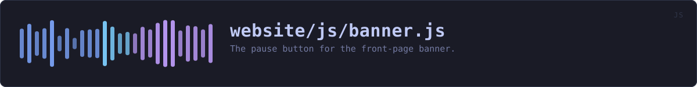
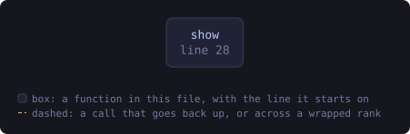

<!-- GENERATED by tools/docs/sources.py from the header comment in the source. Do not edit: edit the source file and run the generator. -->

# `website/js/banner.js`

[[The website's source|Source-index]] &middot; 39 lines &middot; [read the source](https://github.com/tilas01/veilvoice/blob/main/website/js/banner.js)

## What it does

The pause button for the front-page banner.

For most readers the banner animates and there is no button: `.bn-pause` is hidden by CSS. A reader whose system asks for reduced motion sees the banner keep a slow sweep running (see "calmer, not frozen" in main.css), and anything that moves for more than five seconds should be possible to stop, so for them the button appears and this file makes it work.

The state lives in one class on the banner, `bn-paused`, which the reduced motion block in main.css reads. The button's `aria-pressed` and its label follow that class, so a screen reader hears what the button will do next.

## In plain words

If you have asked your computer for less movement, a small button under the banner lets you stop its slow glow, and press it again to start it.

## What calls what

Read out of the source: an edge means the callee's name appears,
called, inside the caller's body. A syntactic reading, not a
resolved one.

| Function | Line |
|---|---:|
| `show` | 28 |
